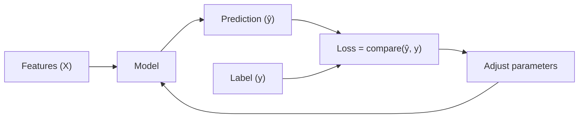

# 0.1 Machine Learning Mental Model

### Introduction
Before learning any algorithm, you need a picture of **what training actually does**. Without it, every model looks like a different magic trick. With it, every model becomes a variation on one loop.

If you understand **guess → measure error → adjust**, you understand 90% of Machine Learning.

### Objective
Build a single mental model that explains how all supervised learning works, and learn the vocabulary (features, labels, parameters, loss) used in every later lesson.

---

### 🎯 The "Dartboard" Concept
Think of training a model like a **blindfolded dart player with a coach**:

#### 1. The Guess (Prediction)
- **What it is:** The model takes an input (a house's size, age, location) and produces an output (a predicted tax amount).
- **At first:** The guess is random. The player has never thrown a dart.

#### 2. The Measurement (Loss Function)
- **What it is:** A number that says *how wrong* the guess was. Predicted $4,200, actual $5,000 — the error is $800.
- **Why we need it:** Without a score, there is no way to know whether a change helped.

#### 3. The Adjustment (Optimization)
- **What it is:** The coach says "a little more to the left." The model nudges its internal numbers (**parameters** or **weights**) to reduce the error.
- **Repeat:** Thousands of throws later, the darts cluster near the bullseye.

---

### 🔁 The Training Loop



Key vocabulary you will see everywhere:

| Term | Meaning | Example |
| ---- | ------- | ------- |
| **Feature** | An input column | `floor_area`, `year_built` |
| **Label / Target** | What you want to predict | `tax_amount` |
| **Parameter / Weight** | A number the model learns | slope of a line |
| **Hyperparameter** | A setting *you* choose before training | tree depth, learning rate |
| **Loss** | How wrong one prediction is | squared error |
| **Epoch** | One full pass over the training data | — |

### Example
Here is the whole loop with no libraries, fitting a straight line `y = w·x + b`:

```python
import numpy as np

X = np.array([50, 80, 120, 150])            # floor area (m²)
y = np.array([1000, 1600, 2400, 3000])      # tax amount

w, b = 0.0, 0.0            # 1. start with a bad guess
lr = 0.00005               # how big each adjustment is

for epoch in range(2000):
    y_pred = w * X + b                       # 2. predict
    error = y_pred - y
    loss = np.mean(error ** 2)               # 3. measure (MSE)
    w -= lr * np.mean(2 * error * X)         # 4. adjust
    b -= lr * np.mean(2 * error)

print(f"w={w:.2f}, b={b:.2f}, loss={loss:.2f}")   # w ≈ 20 → $20 per m²
```

Every model in this course — linear regression, XGBoost, a neural network — is some version of this loop with a smarter "model" box and a smarter "adjust" step.

### 2 Use Cases
1. **Debugging a bad model:** When accuracy is poor you can ask: is the *data* wrong (features/labels), is the *loss* wrong (optimizing the wrong thing), or is the *adjustment* wrong (learning rate, too few epochs)? The mental model gives you a checklist.
2. **Explaining ML to stakeholders:** "The system looked at 50,000 past cases and found the pattern that minimizes its mistakes" is understandable and honest, and it sets correct expectations about data quality.

### Real-World Context
In **production ML**, this loop runs offline during training, and only the frozen parameters ship to the API. That is why a deployed model does not "keep learning" unless you deliberately retrain it — a common misconception from managers.
In **LLM systems**, the same loop trained the language model you call through LangChain: predict the next token, measure the loss, adjust billions of weights. Fine-tuning is simply resuming that loop on your own data.

### Did you know?
The "adjust" step in the example is **gradient descent**, invented by Cauchy in 1847 — more than a century before computers. You will implement it properly in [Regression 2.1](../01_regression/02_intermediate/2.1_gradient_descent.md).

**Next:** [0.2 Types of Machine Learning](0.2_types_of_ml.md)
