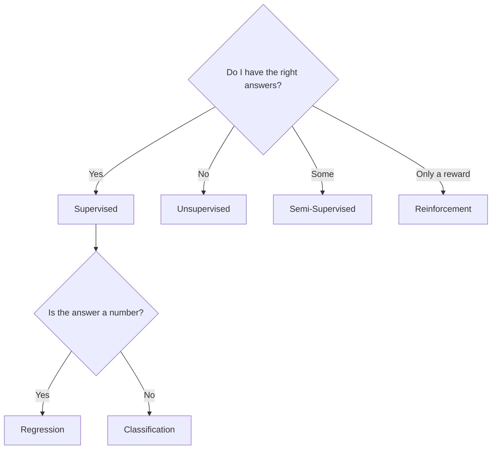

# 0.2 Types of Machine Learning

### Introduction
"Which algorithm should I use?" is the wrong first question. The right first question is **"What kind of answer do I have in my data?"** The answer places you in one of four families, and each family has its own algorithms, metrics, and pitfalls.

### Objective
Recognize the four types of Machine Learning, know which one a business problem belongs to, and map each type to the modules in this course.

### Concept
The deciding factor is **what the training data contains**:

| Type | Do you have labels? | You want to... | Course modules |
| ---- | ------------------- | -------------- | -------------- |
| **Supervised** | Yes, every row has the right answer | Predict a number or category | 01 Regression, 02 Classification, 03 Ensemble, 07 Time Series |
| **Unsupervised** | No labels | Find structure, groups, or patterns | 04 Clustering, 05 Dimensionality, 08 Association |
| **Semi-Supervised** | A few labels, many unlabeled rows | Stretch a small labeled set | Covered inside 02 / 06 |
| **Reinforcement** | No labels, but a reward signal | Learn a sequence of actions | Out of scope (mentioned in 06) |

#### 1. Supervised Learning (The Teacher)
You show the model inputs *and* correct outputs. It learns the mapping.
- **Regression:** output is a number — tax amount, temperature, revenue.
- **Classification:** output is a category — approved/rejected, which department.

#### 2. Unsupervised Learning (The Explorer)
No answers are given. The model looks for natural groupings or compact representations.
- **Clustering:** which neighborhoods have similar complaint profiles?
- **Dimensionality reduction:** compress 40 KPI columns into 3 meaningful axes.
- **Association rules:** which complaint types co-occur in the same district?

#### 3. Semi-Supervised Learning (The Apprentice)
Labeling is expensive (someone must read every complaint). Train on the 500 labeled examples, then let the model confidently label the 50,000 unlabeled ones and retrain.

#### 4. Reinforcement Learning (The Gamer)
An agent takes actions, receives rewards, and learns a policy. Used in robotics, game playing, and traffic-signal control.



### Example
The same dataset can host different problem types depending on the question:

```python
import pandas as pd

complaints = pd.DataFrame({
    "text":      ["pothole on main st", "water leak", "garbage not collected", "street light out"],
    "district":  ["north", "east", "north", "west"],
    "lat":       [14.60, 14.58, 14.61, 14.55],
    "lon":       [121.00, 121.05, 121.01, 120.98],
    "department": ["roads", "water", "sanitation", "roads"],   # label (sometimes missing!)
    "days_to_close": [5, 12, 2, 7],
})

# Supervised classification: text -> department
X_cls, y_cls = complaints["text"], complaints["department"]

# Supervised regression: features -> days_to_close
X_reg, y_reg = complaints[["district", "lat", "lon"]], complaints["days_to_close"]

# Unsupervised clustering: find hotspots from coordinates only (no label)
X_clu = complaints[["lat", "lon"]]
```

Same table, three problem types. The **question** determines the type, not the data.

### 2 Use Cases
1. **Supervised → Regression:** Predict annual property tax revenue from assessment records (Capstone 01).
2. **Unsupervised → Clustering:** Group complaint coordinates into geographic hotspots when no "hotspot" label exists (Capstone 04).

### Real-World Context
In **production ML**, most business value comes from supervised learning because the output maps directly to a decision. Unsupervised methods are often used *upstream* — to explore data, engineer features, or detect anomalies — before a supervised model is trained.
In **LLM systems**, pretraining a language model is **self-supervised** (the "label" is just the next word), while RLHF — the step that makes a chat model polite and helpful — is reinforcement learning with human feedback.

### Did you know?
Many "unsupervised" wins are quietly converted into supervised problems. A team clusters customers, names the clusters, and then trains a classifier to assign new customers to those names. Knowing the four types lets you see these conversions and choose them deliberately.

**Next:** [0.3 Python for Machine Learning](0.3_python_for_ml.md)
