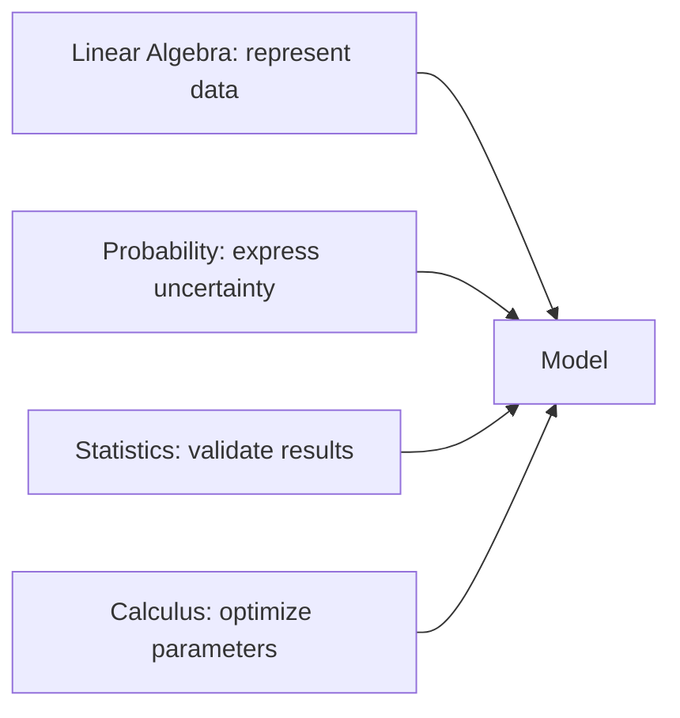

# 0.4 Mathematics for ML

### Introduction
You do not need a math degree to do Machine Learning, but you do need **intuition** for four areas: linear algebra, probability, statistics, and calculus. Each one answers a specific question that comes up every time you train a model.

### Objective
Build working intuition for the math behind ML — enough to read a model's documentation, understand why it fails, and know what a hyperparameter actually changes.

---

### 📐 The Four Pillars

#### 1. Linear Algebra — *"How is data represented?"*
- **Vectors:** One row of data is a vector — a point in feature space. A house with `(area=120, age=10)` is a point in 2-D.
- **Matrices:** The whole dataset is a matrix `X` of shape `(n_samples, n_features)`.
- **Dot product:** `w · x = w₁x₁ + w₂x₂ + …` is the heart of linear regression, logistic regression, and every neural network layer. A prediction is just a weighted sum.
- **Distance:** `‖a − b‖` tells you how similar two rows are — the basis of KNN and K-Means.

#### 2. Probability — *"How confident is the model?"*
- **Probability distributions:** Describe how values spread. The normal (bell) curve shows up everywhere.
- **Conditional probability:** `P(spam | contains "free")` — the engine of Naive Bayes.
- **Bayes' theorem:** Update a belief when new evidence arrives.
- **Why it matters:** A classifier outputs `P(class | features)`. Understanding probability lets you set thresholds sensibly.

#### 3. Statistics — *"Can I trust what I see?"*
- **Mean, median, variance, standard deviation:** Summaries you compute in EDA.
- **Correlation:** Does `floor_area` move with `tax_amount`? (Correlation ≠ causation.)
- **Sampling and bias:** Your training set is a *sample*. If it is unrepresentative, the model learns the wrong world.
- **Hypothesis testing:** Is Model B *really* better than Model A, or is the difference noise?

#### 4. Calculus — *"How does the model improve?"*
- **Derivative:** The slope — how much the loss changes if a parameter moves a little.
- **Gradient:** The vector of all partial derivatives. It points *uphill*; training steps *downhill*.
- **Chain rule:** How gradients flow backward through a neural network (backpropagation).



### Example
Each pillar in a few lines of NumPy:

```python
import numpy as np

# --- Linear algebra: a prediction is a dot product ---
x = np.array([120, 10])            # one house: area, age
w = np.array([20, -15])            # learned weights
b = 500
prediction = w @ x + b             # 20*120 - 15*10 + 500 = 2750
print(prediction)

# --- Linear algebra: distance between two houses ---
other = np.array([100, 12])
print(np.linalg.norm(x - other))   # Euclidean distance ≈ 20.1

# --- Probability: Bayes' theorem ---
p_leak = 0.05                      # P(water leak complaint)
p_east_given_leak = 0.60           # P(district=east | leak)
p_east = 0.25                      # P(district=east)
print(p_east_given_leak * p_leak / p_east)   # P(leak | east) = 0.12

# --- Statistics: correlation ---
area = np.array([50, 80, 120, 150, 200])
tax = np.array([1000, 1700, 2300, 3100, 3900])
print(np.corrcoef(area, tax)[0, 1])          # ≈ 0.99 — strong linear relationship

# --- Calculus: numerical derivative of the loss w.r.t. w ---
def loss(w):
    return np.mean((w * area - tax) ** 2)

h = 1e-5
gradient = (loss(20 + h) - loss(20 - h)) / (2 * h)
print(gradient)                    # negative → increasing w lowers the loss
```

### 2 Use Cases
1. **Choosing a distance metric:** Clustering complaint locations by latitude/longitude with Euclidean distance works for a city; for nationwide data you need haversine distance because the Earth is curved. Linear algebra tells you *why* the metric matters.
2. **Deciding on a probability threshold:** A fraud model outputs `P(fraud) = 0.3`. Whether you flag the case depends on the cost of a false alarm versus a missed fraud — a probability and statistics question, not an algorithm question.

### Real-World Context
In **production ML**, statistics is the pillar that saves you from embarrassment: a model that scores 95% on a test set drawn from the wrong population will fail in the field. Always ask "Is my sample representative of what the model will see in production?"
In **LLM systems**, embeddings are vectors and similarity search is a dot product (cosine similarity). When you tune `k` in a LangChain retriever or compare chunking strategies, you are reasoning about linear algebra and distance.

### Did you know?
Every layer of a neural network is literally `activation(W @ x + b)` — a matrix multiplication followed by a non-linear squish. GPUs are fast at ML because they were built to multiply matrices for 3-D graphics.

**Next:** [0.5 Data Understanding & EDA](0.5_eda.md)
