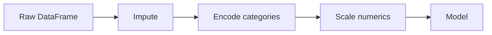

# 0.6 Data Preprocessing

**Exercise:** [0.6_preprocessing.ipynb](../../../Exercises/MachineLearning/00_foundations/0.6_preprocessing.ipynb)

### Introduction
Models eat **numbers with no gaps**. Real data has text labels, missing cells, wildly different scales, and the occasional absurd value. Preprocessing is the bridge — and because every transformation must be replayed identically at prediction time, it is also where most production bugs hide.

### Objective
Handle the four standard preprocessing tasks — missing values, encoding, scaling, outliers — using scikit-learn transformers that can be fit once and reused safely.

---

### 🏭 The "Assembly Line" Concept
Preprocessing is a series of stations. Each station is a **transformer** with two verbs:

- **`fit(X_train)`** — learn what to do (the mean to fill with, the categories that exist, the scale).
- **`transform(X)`** — apply it to any data, training *or* new.

The golden rule: **fit on training data only**, then transform both train and test. Fitting on the full dataset leaks information from the test set into the model.

#### Station 1 — Missing Values (`SimpleImputer`)
- **Numeric:** fill with median (robust to outliers) or mean.
- **Categorical:** fill with most frequent, or a literal `"missing"` category.
- **Advanced:** `KNNImputer`, or add a `was_missing` indicator column — the fact that a value is absent is often predictive.

#### Station 2 — Encoding Categories
- **One-Hot (`OneHotEncoder`):** `district = north` → `[1, 0, 0, 0]`. Safe default for low-cardinality features.
- **Ordinal (`OrdinalEncoder`):** `size = small/medium/large` → `0/1/2`. Only when order is meaningful.
- **Target / frequency encoding:** For high-cardinality columns (thousands of street names). Covered in Regression 3.1.

#### Station 3 — Scaling
- **`StandardScaler`:** mean 0, std 1. Default for linear models, SVM, KNN, neural networks.
- **`MinMaxScaler`:** squash to [0, 1]. Useful for neural networks and when bounds matter.
- **`RobustScaler`:** uses median and IQR, so outliers do not dominate.
- **Tree-based models (Random Forest, XGBoost) do not need scaling.**

#### Station 4 — Outliers
- Detect with IQR rule (`< Q1 − 1.5·IQR` or `> Q3 + 1.5·IQR`) or z-score.
- Decide: **cap** (winsorize), **transform** (`log1p`), or **remove** — only if the value is an error, not a rare truth.



### Example
The production-grade way: a `ColumnTransformer` that routes each column type to the right stations, wrapped in a `Pipeline` so `fit` and `transform` can never go out of sync.

```python
import numpy as np
import pandas as pd
from sklearn.compose import ColumnTransformer
from sklearn.impute import SimpleImputer
from sklearn.pipeline import Pipeline
from sklearn.preprocessing import OneHotEncoder, StandardScaler
from sklearn.linear_model import LinearRegression
from sklearn.model_selection import train_test_split

df = pd.read_csv("Datasets/MachineLearning/sample/property_assessments.csv")

# Tame a skewed target and an obvious error value
df = df[df["floor_area"] > 0]
y = np.log1p(df["tax_amount"])
X = df.drop(columns=["tax_amount"])

numeric_cols = ["floor_area", "year_built", "lot_size"]
categorical_cols = ["district", "property_type"]

numeric_pipe = Pipeline([
    ("impute", SimpleImputer(strategy="median")),
    ("scale", StandardScaler()),
])
categorical_pipe = Pipeline([
    ("impute", SimpleImputer(strategy="most_frequent")),
    ("onehot", OneHotEncoder(handle_unknown="ignore")),   # new category at inference? → all zeros, no crash
])

preprocess = ColumnTransformer([
    ("num", numeric_pipe, numeric_cols),
    ("cat", categorical_pipe, categorical_cols),
])

model = Pipeline([
    ("prep", preprocess),
    ("reg", LinearRegression()),
])

X_train, X_test, y_train, y_test = train_test_split(X, y, test_size=0.2, random_state=42)
model.fit(X_train, y_train)          # fits imputers/scalers on TRAIN ONLY, then the regressor
print(model.score(X_test, y_test))   # transform is applied automatically to X_test
```

One object, one `fit`, one `predict`. Save it with `joblib.dump(model, "model.joblib")` and the API gets the identical preprocessing for free.

### 2 Use Cases
1. **Unseen categories in production:** A new district is created after the model is trained. `OneHotEncoder(handle_unknown="ignore")` keeps the API alive instead of raising `ValueError` on the first request.
2. **Scale-sensitive models:** Clustering properties by `(floor_area in m², price in pesos)` without scaling makes price dominate completely — every cluster is just a price band. `StandardScaler` puts both features on equal footing.

### Real-World Context
In **production ML**, the single most common bug is **training-serving skew**: the notebook filled missing values with the training median, but the API fills them with zero. Pipelines eliminate this class of bug by design, which is why every advanced module in this course uses them.
In **LLM / RAG systems**, preprocessing is chunking, cleaning, and deduplicating documents before embedding. The same discipline applies: the cleaning function you use at index time must be the one you use at query time.

### Did you know?
Imputing with the mean *before* splitting into train and test is one of the most common forms of data leakage in Kaggle notebooks — the test rows influence the fill value. The effect is small but real, and in regulated industries (credit, insurance) it can invalidate a model audit.

**Next:** [0.7 Training & Testing](0.7_train_test.md)
