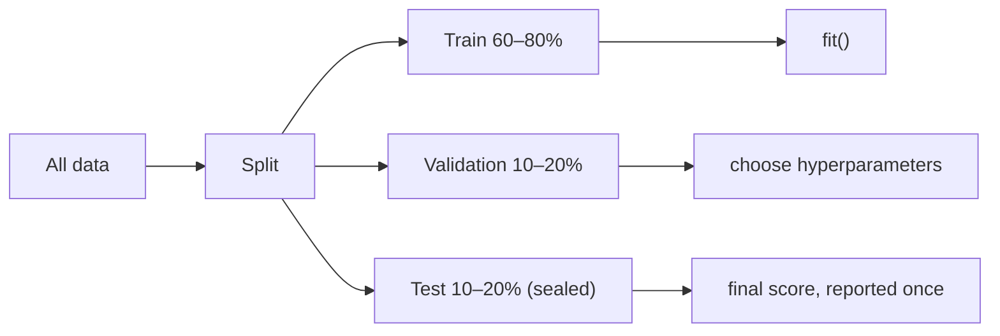

# 0.7 Training & Testing

**Exercise:** [0.7_train_test.ipynb](../../../Exercises/MachineLearning/00_foundations/0.7_train_test.ipynb)

### Introduction
A model that scores 100% on the data it was trained on has proven nothing — it may have memorized the answers. The entire discipline of ML evaluation rests on one idea: **judge the model on data it has never seen.**

### Objective
Split data correctly, use cross-validation for trustworthy estimates, and recognize overfitting and underfitting when you see them.

---

### 📝 The "Exam" Concept
Think of training like a student preparing for an exam:

- **Training set** — the textbook and practice problems. The model studies here.
- **Validation set** — mock exams. You use these to pick study strategies (hyperparameters).
- **Test set** — the final exam. Opened **once**, at the very end. If you peek and adjust, it is no longer a fair test.

#### Overfitting (The Memorizer)
The student memorized every practice answer but cannot solve a new problem. **Low training error, high test error.** Model is too complex for the data.

#### Underfitting (The Slacker)
The student did not study enough to learn even the basics. **High training error, high test error.** Model is too simple.

#### The Sweet Spot
Both errors are low and close together. This is **generalization** — the only thing that matters.



#### Cross-Validation (Many Mock Exams)
A single validation split is noisy — you might get lucky. **K-fold cross-validation** splits the training data into *k* parts, trains *k* times (each part takes a turn as validation), and averages the scores. `k = 5` or `10` is standard.

#### Splits That Respect Reality
- **Stratified split:** keeps class proportions equal in train/test. Essential for imbalanced classification.
- **Time-based split:** for time series, train on the past and test on the future. A random split would let the model "see tomorrow".
- **Group split:** if the same property appears in multiple rows (yearly assessments), keep all its rows on one side. Otherwise the model memorizes the property, not the pattern.

### Example
```python
import numpy as np
from sklearn.datasets import make_regression
from sklearn.linear_model import LinearRegression
from sklearn.model_selection import train_test_split, cross_val_score, KFold
from sklearn.pipeline import make_pipeline
from sklearn.preprocessing import PolynomialFeatures

X, y = make_regression(n_samples=200, n_features=1, noise=25, random_state=0)

# 1. Hold out a sealed test set FIRST
X_train, X_test, y_train, y_test = train_test_split(X, y, test_size=0.2, random_state=42)

# 2. Compare model complexities with 5-fold CV on the training set only
cv = KFold(n_splits=5, shuffle=True, random_state=42)
for degree in [1, 3, 15]:
    model = make_pipeline(PolynomialFeatures(degree), LinearRegression())
    scores = cross_val_score(model, X_train, y_train, cv=cv, scoring="r2")
    model.fit(X_train, y_train)
    print(f"degree={degree:>2} | train R²={model.score(X_train, y_train):.3f} "
          f"| CV R²={scores.mean():.3f} ± {scores.std():.3f}")

# Typical output:
# degree= 1 | train R²=0.78 | CV R²=0.76   ← good fit
# degree= 3 | train R²=0.79 | CV R²=0.75   ← no gain from complexity
# degree=15 | train R²=0.86 | CV R²=0.41   ← OVERFITTING: train up, CV collapses

# 3. Pick the winner, retrain on all training data, score the test set ONCE
best = make_pipeline(PolynomialFeatures(1), LinearRegression()).fit(X_train, y_train)
print("Final test R²:", round(best.score(X_test, y_test), 3))
```

For classification, swap in `StratifiedKFold`; for time series, `TimeSeriesSplit`; for repeated entities, `GroupKFold`.

### 2 Use Cases
1. **Catching a too-good-to-be-true result:** A tax-risk model scored 99% in the notebook. A `GroupKFold` by `property_id` dropped it to 71% — the random split had put the same properties in both train and test, and the model had memorized them.
2. **Choosing between algorithms fairly:** Running Random Forest, XGBoost, and Logistic Regression through the *same* 5-fold CV gives comparable mean ± std scores, so you pick on evidence rather than on one lucky split.

### Real-World Context
In **production ML**, the test set is a stand-in for *the future*. The closer your split mimics deployment conditions (time ordering, new properties, new districts), the fewer surprises after launch. Many teams keep a **frozen golden test set** that every model version is scored against.
In **LLM / RAG systems**, the same rule applies to evaluation sets: if you tune your prompts on the same 50 questions you report accuracy on, the number is meaningless. Keep a held-out question set, exactly like a test split.

### Did you know?
The 80/20 split is a convention, not a law. With 10 million rows, a 1% test set is plenty. With 300 rows, you should rely on cross-validation and treat any single split with suspicion. The question is always "is the test set big enough to trust the score?"

**Next:** [0.8 Model Evaluation Fundamentals](0.8_evaluation.md)
