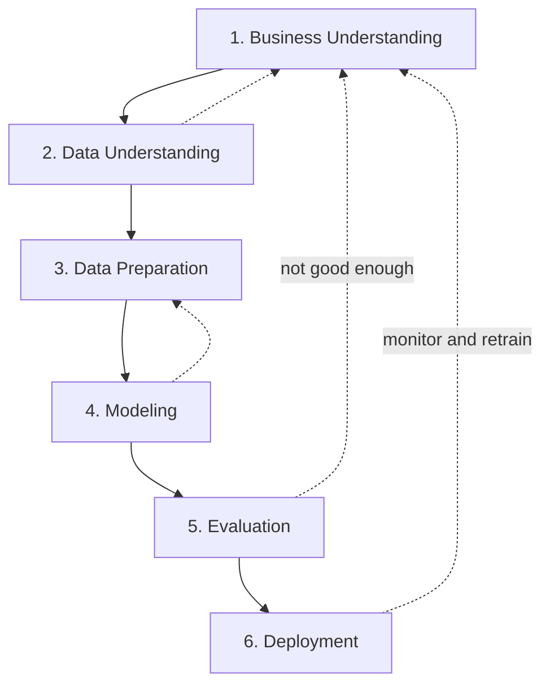

# 0.9 CRISP-DM Workflow

**Exercise:** [0.9_crisp_dm.ipynb](../../../Exercises/MachineLearning/00_foundations/0.9_crisp_dm.ipynb)

### Introduction
Most ML projects do not fail because the algorithm was wrong. They fail because nobody agreed on the business question, the data could not support it, or the model never made it out of the notebook. **CRISP-DM** (Cross-Industry Standard Process for Data Mining) is the 25-year-old checklist that prevents those failures — and every capstone in this course follows it.

### Objective
Know the six CRISP-DM phases, what deliverable each one produces, and how to use the framework to scope a real project before writing any code.

---

### 🗺️ The "Expedition" Concept
A data project is an expedition: you need a destination, a map of the terrain, supplies, the journey itself, a check that you arrived, and a way to bring the results home.



The arrows going backward are not failures — they are the normal path. Expect to loop.

#### 1. Business Understanding — *What decision will this model change?*
- Define the objective in business terms: "reduce overdue property tax by identifying high-risk accounts 60 days early."
- Translate it into an ML task: binary classification, target = `overdue_90d`.
- Agree on **success criteria**: "recall ≥ 0.70 at precision ≥ 0.40, beating the current rule-based list."
- **Deliverable:** a one-page project charter.

#### 2. Data Understanding — *Do we have the data to answer it?*
- Inventory sources (assessment DB, payment history, GIS).
- Run EDA ([0.5](0.5_eda.md)). Check quality, coverage, and whether the target can actually be constructed.
- **Deliverable:** data dictionary + EDA report + list of risks (missing years, leakage candidates).

#### 3. Data Preparation — *Build the modeling table.*
- Join, clean, engineer features, encode, scale ([0.6](0.6_preprocessing.md)).
- Define the train/validation/test split that mirrors deployment ([0.7](0.7_train_test.md)).
- Typically **60–80% of project time.**
- **Deliverable:** a reproducible feature pipeline (code, not clicks).

#### 4. Modeling — *Try algorithms, tune, compare.*
- Start with a baseline, then simple models, then complex ones.
- Use cross-validation; record every experiment.
- **Deliverable:** a comparison table and the chosen model artifact.

#### 5. Evaluation — *Does it meet the business criteria?*
- Score on the sealed test set with the metrics from phase 1 ([0.8](0.8_evaluation.md)).
- Review with stakeholders: are the errors acceptable? Is anything unfair to a district or property type?
- Decide: deploy, iterate, or stop.
- **Deliverable:** evaluation report + go/no-go decision.

#### 6. Deployment — *Put it to work and keep it working.*
- Package the pipeline (joblib / ONNX), expose via FastAPI, containerize with Docker.
- Monitor inputs (data drift) and outputs (performance drift); schedule retraining.
- **Deliverable:** running service, monitoring dashboard, runbook.

### Example
A CRISP-DM project charter as code — the template each capstone `README.md` follows:

```python
project = {
    # 1. Business Understanding
    "objective":   "Identify properties likely to be >90 days overdue on tax, 60 days before due date",
    "decision":    "Collections team prioritizes outreach list weekly",
    "ml_task":     "binary classification",
    "target":      "overdue_90d",
    "success":     {"recall": ">= 0.70", "precision": ">= 0.40", "beats": "current rule-based list"},

    # 2. Data Understanding
    "sources":     ["assessments (yearly)", "payments (transactional)", "parcels GIS"],
    "grain":       "one row per property per tax year",
    "risks":       ["payments table starts 2019", "no owner income data", "paid_date leaks target"],

    # 3. Data Preparation
    "features":    ["assessed_value", "years_owned", "prior_late_payments", "district", "property_type"],
    "excluded":    ["paid_date", "amount_paid"],          # leakage
    "split":       "time-based: train 2019–2023, validate 2024, test 2025",

    # 4. Modeling
    "candidates":  ["DummyClassifier", "LogisticRegression", "RandomForest", "XGBoost"],
    "cv":          "StratifiedKFold(5) inside training years",

    # 5. Evaluation
    "report":      ["confusion matrix", "precision/recall by district", "PR curve"],

    # 6. Deployment
    "serving":     "FastAPI /predict, Docker, weekly batch scoring",
    "monitoring":  ["feature drift (PSI)", "monthly recall vs. actuals", "retrain quarterly"],
}
```

Notice that `"excluded"` is decided in phase 3 because of a risk found in phase 2 — the loop in action.

### 2 Use Cases
1. **Scoping a capstone:** Before building the complaint classifier (Capstone 02), the charter forces the question "what happens to a misrouted complaint?" — which determines whether you optimize for precision or recall before writing a line of code.
2. **Killing a bad project early:** Phase 2 reveals that payment data exists only for three years and lacks any owner attributes. The team decides the model cannot beat the current rule, and stops — saving two months.

### Real-World Context
In **production ML**, CRISP-DM maps directly onto modern **MLOps**: phases 3–4 become training pipelines, phase 5 becomes model registries with approval gates, and phase 6 becomes CI/CD plus monitoring. The names changed; the discipline did not.
In **LLM / RAG systems**, the same framework applies with different artifacts: business understanding defines which questions the assistant must answer; data understanding is a corpus audit; preparation is chunking and indexing; modeling is prompt and retriever design; evaluation is a held-out question set (LangChain 3.6); deployment is LangServe plus monitoring (LangChain 3.7).

### Did you know?
CRISP-DM was published in 1999 by a consortium including Daimler, SPSS, and NCR, and surveys still rank it the most-used data science methodology. Its longevity comes from a simple truth it encodes: **the business question comes first, and the model is the smallest part of the project.**

**Next:** [01 Regression — 1.1 Introduction to Regression](../01_regression/01_beginner/1.1_intro_regression.md)
