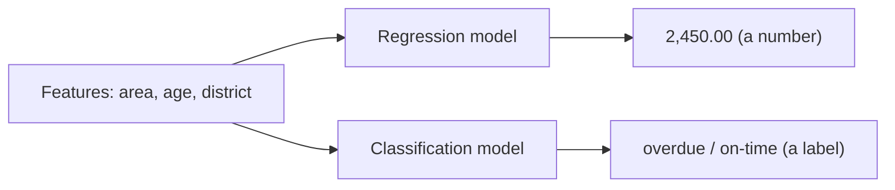

# 1.1 Introduction to Regression

### Introduction
Regression is the first algorithm family most people learn, and for good reason: it is the simplest model that produces a **number** as its answer. How much tax will this property owe? What will revenue be next quarter? How many days until this complaint is closed? If the question ends in a quantity, you are doing regression.

### Objective
Understand what makes a problem a regression problem, how it differs from classification, and what the regression modules in this course will build toward.

---

### 📏 The "Ruler vs. Sorting Hat" Concept

#### Regression (The Ruler)
- **Output:** a continuous number on a scale — ₱2,450.00, 37.2°C, 12.5 days.
- **Question shape:** *"How much?"* / *"How many?"*
- **Error:** measured as a *distance* — you were off by ₱300.

#### Classification (The Sorting Hat)
- **Output:** one of a fixed set of labels — `approved` / `rejected`, `roads` / `water` / `sanitation`.
- **Question shape:** *"Which one?"*
- **Error:** measured as *right or wrong* — you put it in the wrong bucket.

The same features can feed either. Predicting `tax_amount` is regression; predicting `will_be_overdue` is classification. The **target column** decides.



#### Where the line gets blurry
- **Counts** (number of complaints per month) are numbers but discrete. Usually treated as regression, sometimes as Poisson regression.
- **Ordered categories** (low / medium / high risk) can go either way — ordinal classification or regression on a 1–3 scale.
- **Probabilities** are numbers, but predicting `P(overdue)` is still classification because the *decision* is a label.

### Example
A regression problem in its most minimal form — one feature, one numeric target, and a fitted line:

```python
import numpy as np
import matplotlib.pyplot as plt
from sklearn.linear_model import LinearRegression

# Floor area (m²) → annual property tax (₱)
area = np.array([[45], [60], [75], [90], [110], [130], [160], [200]])
tax  = np.array([ 900, 1250, 1500, 1800, 2300, 2600, 3300, 4100])

model = LinearRegression().fit(area, tax)

print(f"tax ≈ {model.coef_[0]:.1f} × area + {model.intercept_:.0f}")
print("Predicted tax for 120 m²:", round(model.predict([[120]])[0]))

plt.scatter(area, tax, label="observed")
plt.plot(area, model.predict(area), color="red", label="fitted line")
plt.xlabel("floor area (m²)"); plt.ylabel("tax (₱)"); plt.legend()
```

The model learned two numbers — a slope and an intercept — and that is enough to produce a prediction for any area, including ones it never saw.

### 2 Use Cases
1. **Property tax revenue:** Predict the annual tax owed per parcel from assessed value, area, age, and district so the treasury can budget before bills are issued (Capstone 01).
2. **Service time estimation:** Predict days-to-resolution for a new complaint from its category, district, and backlog so the hotline can give citizens a realistic ETA.

### Real-World Context
In **production ML**, linear regression is often the model that *ships*, even when a gradient-boosted model scores slightly better. It is fast, interpretable, and auditable — a tax authority can explain "₱18.70 per square metre" to a citizen, but not a 500-tree ensemble. Learn the simple model deeply; the advanced modules show when to trade it away.
In **LLM / RAG systems**, regression appears as **re-ranking**: a model scores each retrieved chunk with a relevance number, and the top-k scores win. The LLM reads the text, but a regressor decided what it reads.

### Did you know?
The word *regression* comes from Francis Galton's 1886 study of heights: tall parents tended to have children closer to average height — they "regressed toward the mean." The statistical technique kept the name even though it now has nothing to do with going backward.

**Next:** [1.2 Simple Linear Regression](1.2_simple_linear.md)
