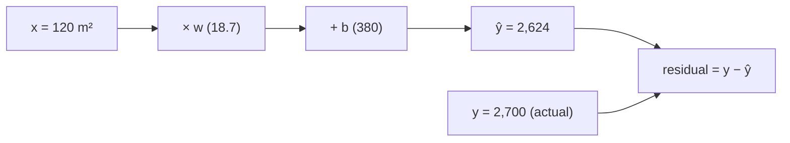

# 1.2 Simple Linear Regression

**Exercise:** [1.2_simple_linear.ipynb](../../../../Exercises/MachineLearning/01_regression/01_beginner/1.2_simple_linear.ipynb)

### Introduction
Simple linear regression fits a straight line through data using **one** feature. It is the smallest useful model in all of Machine Learning, and almost every idea you will meet later — loss, fitting, residuals, overfitting — can be seen clearly on a single line.

If you understand `y = w·x + b`, you understand the skeleton of every neural network.

### Objective
Fit a line with scikit-learn, understand what the slope and intercept mean in business terms, and know what the algorithm is actually minimizing.

---

### 📐 The "Best Ruler" Concept
Imagine a scatter of dots and a ruler you can slide and tilt. **Which position is best?**

#### 1. The Model
`ŷ = w · x + b`
- **`w` (slope / coefficient):** how much `y` changes when `x` increases by 1. *"Each extra m² adds ₱18.70 of tax."*
- **`b` (intercept):** the predicted `y` when `x = 0`. Often not meaningful on its own (a 0 m² house), but needed to position the line.

#### 2. The Residual
For each dot, the **residual** is `actual − predicted` = how far the dot is above or below the line. Positive means the model under-predicted.

#### 3. The Loss — Ordinary Least Squares (OLS)
Square every residual (so negatives do not cancel positives and big misses hurt more), add them up. The best line is the one with the **smallest sum of squared residuals**. For a straight line, there is an exact formula — no iteration needed. scikit-learn's `LinearRegression` uses it.



### Example
```python
import numpy as np
import pandas as pd
import matplotlib.pyplot as plt
from sklearn.linear_model import LinearRegression
from sklearn.model_selection import train_test_split

# Synthetic property data: tax depends on area plus noise
rng = np.random.default_rng(42)
area = rng.uniform(40, 250, size=200)
tax = 18.7 * area + 380 + rng.normal(0, 250, size=200)
df = pd.DataFrame({"floor_area": area, "tax_amount": tax})

X = df[["floor_area"]]        # 2-D: (n_samples, 1 feature) — sklearn requires this shape
y = df["tax_amount"]          # 1-D target

X_train, X_test, y_train, y_test = train_test_split(X, y, test_size=0.2, random_state=42)

model = LinearRegression().fit(X_train, y_train)

print(f"slope w     = {model.coef_[0]:.2f}  ₱ per m²")
print(f"intercept b = {model.intercept_:.0f}")
print(f"R² on test  = {model.score(X_test, y_test):.3f}")

# Residuals: the model's mistakes on unseen data
residuals = y_test - model.predict(X_test)
print(f"mean residual = {residuals.mean():.1f}  (≈ 0 if unbiased)")
print(f"std residual  = {residuals.std():.1f}  (typical miss in ₱)")

fig, ax = plt.subplots(1, 2, figsize=(11, 4))
ax[0].scatter(X_test, y_test, alpha=0.5); ax[0].plot(X_test, model.predict(X_test), color="red")
ax[0].set(title="Fitted line on test data", xlabel="floor_area", ylabel="tax_amount")
ax[1].scatter(model.predict(X_test), residuals, alpha=0.5); ax[1].axhline(0, color="red")
ax[1].set(title="Residuals vs predicted", xlabel="predicted", ylabel="residual")
```

**Reading the output:**
- `w ≈ 18.7` recovers the true relationship; `b ≈ 380` positions the line.
- `R² ≈ 0.9+` means the single feature explains most of the variation.
- A residual plot that looks like a shapeless cloud around zero is what you want. A curve or a funnel means a straight line is the wrong shape — see [2.4 Diagnostics](../02_intermediate/2.4_diagnostics.md).

### 2 Use Cases
1. **Rate setting:** A city council asks "how much does tax scale with floor area today?" The fitted slope is a direct, defensible answer — ₱18.70 per m² — that can be compared against the official rate schedule to find systematic under-assessment.
2. **Quick sanity baseline:** Before training anything complex on the full property dataset, a one-feature line on `assessed_value` gives you an R² to beat. If your 40-feature XGBoost model only adds 0.01, the extra complexity is not earning its keep.

### Real-World Context
In **production ML**, a one-feature model is rarely deployed on its own, but the *diagnostic habit* it teaches is permanent: always plot predictions against actuals and residuals against predictions. Those two charts catch more production bugs than any metric.
In **LLM / RAG systems**, the same `w·x + b` appears as the final layer of every embedding and re-ranking model. A cross-encoder that scores chunk relevance is a large feature extractor followed by exactly this linear head.

### Did you know?
The least-squares method was published by Legendre in 1805 and claimed by Gauss, who said he had used it since 1795 to predict the orbit of the asteroid Ceres. The priority dispute never resolved — but the method has been fitting lines for over two centuries.

**Next:** [1.3 Multiple Linear Regression](1.3_multiple_linear.md)
