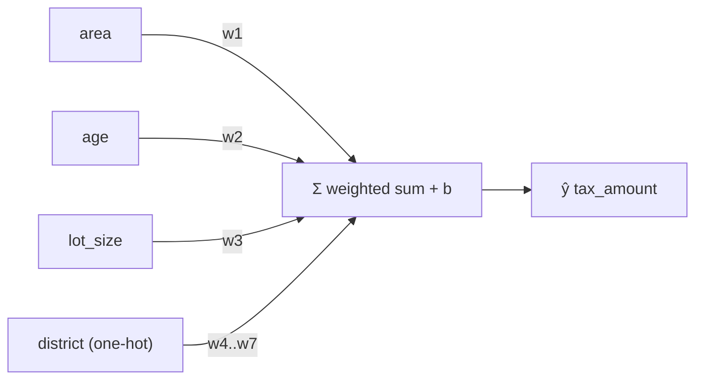

# 1.3 Multiple Linear Regression

**Exercise:** [1.3_multiple_linear.ipynb](../../../../Exercises/MachineLearning/01_regression/01_beginner/1.3_multiple_linear.ipynb)

### Introduction
Real outcomes rarely depend on one thing. Property tax depends on area *and* age *and* district *and* assessed value. Multiple linear regression keeps the straight-line idea but gives every feature its own slope — the model becomes a **weighted sum** of everything you know.

### Objective
Extend the line to many features, interpret each coefficient correctly ("holding everything else constant"), handle categorical features, and recognize when coefficients cannot be trusted.

---

### ⚖️ The "Recipe" Concept
Think of the prediction as a recipe where each ingredient has a quantity:

`ŷ = w₁·area + w₂·age + w₃·lot_size + w₄·is_commercial + … + b`

- Each **`wᵢ`** says: *"if this feature goes up by one unit and nothing else changes, the prediction moves by `wᵢ`."*
- The phrase **"nothing else changes"** is the key. In a one-feature model, the slope absorbed every hidden effect. Now, `w_area` is the effect of area *after accounting for* age, district, and the rest.

#### Categorical features become columns
A linear model cannot multiply "north" by a weight. **One-hot encoding** turns `district` into `district_north`, `district_east`, … each 0 or 1, each with its own coefficient — effectively a separate intercept per district.

#### Scale matters for interpretation, not for fit
A coefficient of `0.002` on `assessed_value` (in ₱) and `450` on `floors` are not comparable. Standardize features (`StandardScaler`) when you want to rank importance; leave them raw when you want business units.

#### Multicollinearity — the coefficient trap
If `floor_area` and `assessed_value` move together almost perfectly, the model cannot tell their effects apart. Predictions stay fine, but individual coefficients become unstable and may even flip sign. Check correlations before interpreting weights.



### Example
```python
import numpy as np
import pandas as pd
from sklearn.compose import ColumnTransformer
from sklearn.linear_model import LinearRegression
from sklearn.model_selection import train_test_split
from sklearn.pipeline import Pipeline
from sklearn.preprocessing import OneHotEncoder, StandardScaler

# Synthetic municipal dataset
rng = np.random.default_rng(7)
n = 600
df = pd.DataFrame({
    "floor_area": rng.uniform(40, 300, n),
    "age":        rng.integers(0, 60, n),
    "lot_size":   rng.uniform(60, 800, n),
    "district":   rng.choice(["north", "east", "south", "west"], n),
})
district_premium = {"north": 600, "east": 0, "south": -300, "west": 250}
df["tax_amount"] = (18 * df["floor_area"] - 12 * df["age"] + 1.5 * df["lot_size"]
                    + df["district"].map(district_premium) + 400 + rng.normal(0, 200, n))

numeric = ["floor_area", "age", "lot_size"]
categorical = ["district"]

prep = ColumnTransformer([
    ("num", "passthrough", numeric),                                   # keep ₱ / m² units for interpretation
    ("cat", OneHotEncoder(drop="first", handle_unknown="ignore"), categorical),  # drop one level → baseline district
])
model = Pipeline([("prep", prep), ("reg", LinearRegression())])

X, y = df.drop(columns="tax_amount"), df["tax_amount"]
X_train, X_test, y_train, y_test = train_test_split(X, y, test_size=0.2, random_state=42)
model.fit(X_train, y_train)
print(f"R² test = {model.score(X_test, y_test):.3f}")

# Name every coefficient
names = model.named_steps["prep"].get_feature_names_out()
coefs = pd.Series(model.named_steps["reg"].coef_, index=names).round(2)
print(coefs)
print("intercept:", round(model.named_steps["reg"].intercept_, 1))

# Check for multicollinearity among numeric features
print(df[numeric].corr().round(2))
```

**Reading the coefficients:** `num__floor_area ≈ 18` → each m² adds ₱18 *holding age, lot size and district fixed*. `cat__district_north ≈ +600` → a north-district property pays about ₱600 more than the dropped baseline (`east`), all else equal. `num__age ≈ −12` → each year of age reduces tax by ₱12.

### 2 Use Cases
1. **Assessment fairness audit:** Fit tax on physical characteristics plus district dummies. A large, significant district coefficient that cannot be explained by property features is evidence of inconsistent assessment practice between offices.
2. **"What-if" budgeting:** Because the model is additive, the treasury can ask "what if we reassess every property older than 40 years?" and compute the revenue impact directly from the `age` coefficient — no retraining required.

### Real-World Context
In **production ML**, multiple linear regression is the workhorse of **explainable pricing and policy** models in finance, insurance, and government, where regulators require that each factor's effect be stated in plain units. Its coefficients *are* the model documentation.
In **LLM / RAG systems**, the "many weighted inputs summed" idea is literally what a single neuron does. A transformer is millions of these recipes stacked with non-linearities between them — [Module 06](../../06_neural_networks/01_beginner/1.1_intro.md) picks up here.

### Did you know?
Adding a feature can *never* lower R² on the training set, even if the feature is random noise. That is why **adjusted R²** exists — it penalizes each extra feature — and why you must judge on held-out data, not training fit ([1.4 Evaluation](1.4_evaluation.md)).

**Next:** [1.4 Regression Evaluation](1.4_evaluation.md)
