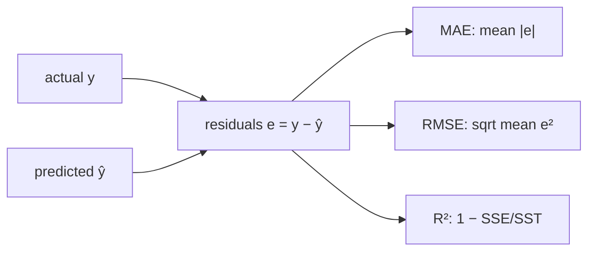

# 1.4 Regression Evaluation

**Exercise:** [1.4_evaluation.ipynb](../../../../Exercises/MachineLearning/01_regression/01_beginner/1.4_evaluation.ipynb)

### Introduction
"The model has an R² of 0.87" means nothing to a treasurer. "The model is typically off by ₱310 per property, and never more than ₱1,200" means everything. Regression evaluation is about choosing metrics that match how the prediction will be *used* — and reporting them in units people understand.

### Objective
Compute and interpret MAE, MSE, RMSE, and R²; know which one to optimize for a given business cost; and always compare against a baseline.

---

### 🎯 The "Four Lenses" Concept
Every metric starts with the same raw material — the residuals `eᵢ = yᵢ − ŷᵢ` — and summarizes them differently.

#### 1. MAE — Mean Absolute Error
`mean(|eᵢ|)`
- **Reads as:** "on average, off by ₱X."
- **Character:** treats a ₱1,000 miss as exactly 10× worse than a ₱100 miss. Robust to a few huge outliers.
- **Use when:** every peso of error costs the same.

#### 2. MSE — Mean Squared Error
`mean(eᵢ²)`
- **Reads as:** awkward — units are ₱².
- **Character:** a ₱1,000 miss counts 100× a ₱100 miss. Punishes big errors hard.
- **Use when:** this is what OLS *minimizes*, so it is the natural training loss; rarely reported to humans.

#### 3. RMSE — Root Mean Squared Error
`√MSE`
- **Reads as:** "typical error ₱X" — back in the target's units.
- **Character:** same big-error sensitivity as MSE, human-readable. RMSE ≥ MAE always; a large gap means some predictions are badly wrong.
- **Use when:** large misses are disproportionately costly (a ₱50,000 under-billing is a scandal; fifty ₱1,000 ones are noise).

#### 4. R² — Coefficient of Determination
`1 − SSE / SST` = 1 − (model's squared error) / (squared error of predicting the mean)
- **Reads as:** "fraction of variance explained." 1.0 is perfect, 0.0 equals the mean baseline, negative is *worse* than guessing the mean.
- **Character:** scale-free, so comparable across datasets. But it says nothing about *how far off in pesos* you are.
- **Use when:** comparing models on the same data. Never as the only metric.

| You care about… | Optimize / report |
| --- | --- |
| Average cost of being wrong | **MAE** |
| Avoiding catastrophic misses | **RMSE** |
| Explaining to technical peers how much signal was captured | **R²** |
| Percent errors (stakeholders think in %) | **MAPE** — but it explodes when `y ≈ 0` |

#### The baseline rule
Always compute the same metrics for `DummyRegressor(strategy="mean")`. A model with MAE ₱310 is excellent if the baseline is ₱1,400 and useless if the baseline is ₱330.



### Example
```python
import numpy as np
import pandas as pd
from sklearn.dummy import DummyRegressor
from sklearn.linear_model import LinearRegression
from sklearn.metrics import (mean_absolute_error, mean_squared_error,
                             r2_score, mean_absolute_percentage_error)
from sklearn.model_selection import train_test_split

rng = np.random.default_rng(3)
n = 500
area = rng.uniform(40, 300, n)
age = rng.integers(0, 60, n)
tax = 18 * area - 12 * age + 500 + rng.normal(0, 300, n)
tax[:5] += 6000                                   # five badly under-assessed outliers
X = pd.DataFrame({"floor_area": area, "age": age}); y = tax
X_train, X_test, y_train, y_test = train_test_split(X, y, test_size=0.25, random_state=42)

def report(name, y_true, y_pred):
    rmse = np.sqrt(mean_squared_error(y_true, y_pred))
    print(f"{name:<10} MAE={mean_absolute_error(y_true, y_pred):>7.0f}  "
          f"RMSE={rmse:>7.0f}  R²={r2_score(y_true, y_pred):>6.3f}  "
          f"MAPE={mean_absolute_percentage_error(y_true, y_pred):>6.1%}")

baseline = DummyRegressor(strategy="mean").fit(X_train, y_train)
model = LinearRegression().fit(X_train, y_train)

report("baseline", y_test, baseline.predict(X_test))
report("linear", y_test, model.predict(X_test))

# Where are the biggest misses? Always look.
res = pd.DataFrame({"actual": y_test, "pred": model.predict(X_test)})
res["abs_err"] = (res["actual"] - res["pred"]).abs()
print(res.sort_values("abs_err", ascending=False).head())
```

**Reading the output:** the baseline R² is ≈ 0 by construction. The linear model should cut MAE by a large factor. If RMSE is much larger than MAE, the `.head()` of worst errors will show the outliers — those rows deserve a conversation with the assessment office, not a fancier model.

### 2 Use Cases
1. **Budget forecasting (RMSE):** A city budget built on predicted collections is hurt far more by one ₱5M miss than by many small ones, so the finance team ranks models on RMSE and inspects the worst-case residuals before approval.
2. **Citizen-facing estimates (MAE):** An online "estimate your property tax" tool promises "typically within ₱300." That promise is literally the MAE, and it is the number the public can hold you to.

### Real-World Context
In **production ML**, evaluation does not stop at launch. The same MAE/RMSE are recomputed monthly on actual bills versus predictions; a rising trend is **model drift** and triggers retraining. Store predictions with timestamps from day one so this comparison is possible.
In **LLM / RAG systems**, numeric evaluation is harder but the discipline transfers: score answers against a held-out set, report several metrics (faithfulness, relevance, latency), and always compare against the "no retrieval" baseline — LangChain [3.6 RAG Evaluation](../../../Langchain/03_advanced/3.6_rag_evaluation.md).

### Did you know?
Because OLS minimizes squared error, a plain linear regression is implicitly optimizing RMSE. If MAE is what the business cares about, you can fit for it directly with `QuantileRegressor(quantile=0.5)` — median regression — which is far less sensitive to outliers.

**Next:** [2.1 Gradient Descent](../02_intermediate/2.1_gradient_descent.md)
