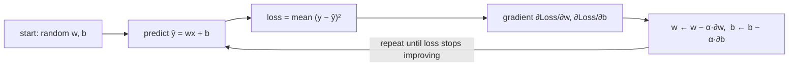

# 2.1 Gradient Descent

**Exercise:** [2.1_gradient_descent.ipynb](../../../../Exercises/MachineLearning/01_regression/02_intermediate/2.1_gradient_descent.ipynb)

### Introduction
`LinearRegression` solves for the best line with a closed-form formula. That works for a few thousand rows and a few dozen features. It does **not** work for ten million rows, or for a neural network with a billion parameters. For those, there is one algorithm: **gradient descent** — the engine behind almost all modern ML training.

### Objective
Understand gradient descent as "walk downhill on the loss surface," implement it from scratch for linear regression, and learn what the learning rate and its variants (batch, stochastic, mini-batch) actually control.

---

### ⛰️ The "Foggy Mountain" Concept
You are standing on a mountainside in thick fog and want to reach the valley floor. You cannot see the valley, but you can feel the slope under your feet.

#### 1. The Landscape (Loss Surface)
Every combination of parameters `(w, b)` has a loss value (MSE). Plot loss against the parameters and you get a surface. The lowest point is the best model. For linear regression the surface is a smooth bowl — one valley, no traps.

#### 2. The Slope (Gradient)
The **gradient** is the vector of partial derivatives `(∂Loss/∂w, ∂Loss/∂b)`. It points in the direction of *steepest ascent*. To go downhill, step in the **opposite** direction.

#### 3. The Step Size (Learning Rate, `α`)
`w ← w − α · ∂Loss/∂w`
- **Too small:** thousands of tiny steps; training takes forever.
- **Too large:** you overshoot the valley and bounce up the other side, possibly diverging to infinity.
- **Just right:** loss drops quickly, then flattens.

#### 4. Variants — how much data per step?
| Variant | Data per step | Character |
| --- | --- | --- |
| **Batch GD** | all rows | exact gradient, slow per step, smooth path |
| **Stochastic GD (SGD)** | 1 row | noisy, fast, can escape shallow traps |
| **Mini-batch GD** | 32–512 rows | the practical default; what PyTorch does |



### Example
Gradient descent for one-feature linear regression, written out so nothing is hidden:

```python
import numpy as np
import matplotlib.pyplot as plt

rng = np.random.default_rng(0)
area = rng.uniform(40, 300, 400)
tax = 18 * area + 500 + rng.normal(0, 300, 400)

# IMPORTANT: scale the feature. GD struggles when features have very different magnitudes.
x = (area - area.mean()) / area.std()
y = tax

def gradient_descent(x, y, lr=0.1, epochs=100):
    w, b = 0.0, 0.0
    history = []
    n = len(x)
    for _ in range(epochs):
        y_hat = w * x + b
        error = y_hat - y
        loss = np.mean(error ** 2)
        dw = (2 / n) * np.sum(error * x)     # ∂MSE/∂w
        db = (2 / n) * np.sum(error)         # ∂MSE/∂b
        w -= lr * dw
        b -= lr * db
        history.append(loss)
    return w, b, history

# Compare learning rates
fig, ax = plt.subplots(figsize=(7, 4))
for lr in [0.01, 0.1, 0.9]:
    w, b, hist = gradient_descent(x, y, lr=lr)
    ax.plot(hist, label=f"lr={lr} → final loss {hist[-1]:,.0f}")
ax.set(xlabel="epoch", ylabel="MSE", yscale="log", title="Learning-rate comparison"); ax.legend()

# Verify against the closed-form solution
w_gd, b_gd, _ = gradient_descent(x, y, lr=0.1, epochs=200)
w_ols, b_ols = np.polyfit(x, y, 1)
print(f"GD : w={w_gd:.2f} b={b_gd:.1f}")
print(f"OLS: w={w_ols:.2f} b={b_ols:.1f}")   # should match to ~2 decimals

# scikit-learn's version: SGDRegressor
from sklearn.linear_model import SGDRegressor
sgd = SGDRegressor(learning_rate="constant", eta0=0.01, max_iter=1000, random_state=0)
sgd.fit(x.reshape(-1, 1), y)
print(f"SGD: w={sgd.coef_[0]:.2f} b={sgd.intercept_[0]:.1f}")
```

**Reading the curves:** `lr=0.01` creeps down slowly; `lr=0.1` converges in a few dozen epochs; `lr=0.9` oscillates or explodes. The learning rate is the first hyperparameter you tune on any gradient-trained model.

### 2 Use Cases
1. **Training on data that does not fit in memory:** A national property registry with 40M parcels cannot be inverted as one matrix. `SGDRegressor.partial_fit` streams the data in chunks, updating weights batch by batch — gradient descent is what makes that possible.
2. **Online learning:** Tax payment behavior shifts over time. A model updated nightly with yesterday's payments via one more gradient step adapts continuously instead of being retrained from scratch.

### Real-World Context
In **production ML**, you will rarely write the gradient by hand again — PyTorch's `autograd` and scikit-learn's solvers do it. But you *will* debug training that diverges (`loss: nan`), stalls, or oscillates, and every one of those symptoms is a learning-rate or feature-scaling problem you now recognize.
In **LLM systems**, every model you call through LangChain was trained with a descendant of this loop — Adam, a mini-batch gradient method with adaptive per-parameter learning rates — over trillions of tokens. Fine-tuning is the same loop resumed on your data.

### Did you know?
Gradient descent was described by Augustin-Louis Cauchy in 1847 for astronomical calculations. It sat mostly unused for a century until computers made iterative methods practical, and today it is arguably the most-executed algorithm on the planet.

**Next:** [2.2 Polynomial Regression](2.2_polynomial.md)
