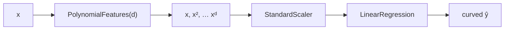

# 2.2 Polynomial Regression

**Exercise:** [2.2_polynomial.ipynb](../../../../Exercises/MachineLearning/01_regression/02_intermediate/2.2_polynomial.ipynb)

### Introduction
Not every relationship is a straight line. Tax per square metre may rise steeply for large luxury properties; building depreciation is fast at first and then levels off. Polynomial regression lets a *linear* model fit *curves* — and in doing so, gives you the clearest possible picture of **overfitting**.

### Objective
Fit curves by engineering polynomial features, see overfitting and underfitting side by side, and learn to pick model complexity with validation data rather than by eye.

---

### 🌊 The "Flexible Ruler" Concept
Polynomial regression is still linear regression — the trick is in the **features**, not the model.

#### 1. Manufacture new features
From a single input `x`, create `x², x³, …, xᵈ`. Now fit an ordinary multiple linear regression on `[x, x², x³]`:

`ŷ = w₁·x + w₂·x² + w₃·x³ + b`

The model is linear *in the weights*, so OLS still solves it exactly. The curve comes from the squared and cubed columns.

#### 2. Degree = flexibility
- **Degree 1:** a straight line. May **underfit** a curved pattern.
- **Degree 2–3:** gentle curves. Usually the sweet spot for real data.
- **Degree 10+:** wiggles through every training point. **Overfits**: perfect on training data, terrible on new data, and wildly wrong outside the training range.

#### 3. Bias–variance trade-off
- **High bias (underfit):** model too rigid to capture the pattern. Train and test error both high.
- **High variance (overfit):** model so flexible it fits the noise. Train error tiny, test error large.
- The best degree minimizes **test** error, not train error.

#### 4. Always scale
`x¹⁰` for `x = 300` is 5.9 × 10²⁴. Wrap `PolynomialFeatures` with `StandardScaler` or the solver will lose precision.



### Example
```python
import numpy as np
import matplotlib.pyplot as plt
from sklearn.linear_model import LinearRegression
from sklearn.model_selection import train_test_split, cross_val_score
from sklearn.pipeline import make_pipeline
from sklearn.preprocessing import PolynomialFeatures, StandardScaler

# Depreciation curve: tax drops fast with age, then plateaus
rng = np.random.default_rng(11)
age = rng.uniform(0, 60, 150)
tax = 3000 * np.exp(-age / 20) + 800 + rng.normal(0, 120, 150)
X, y = age.reshape(-1, 1), tax
X_train, X_test, y_train, y_test = train_test_split(X, y, test_size=0.3, random_state=42)

def poly_model(degree):
    return make_pipeline(PolynomialFeatures(degree), StandardScaler(), LinearRegression())

# 1. Compare degrees with cross-validation on TRAIN only
degrees = range(1, 13)
train_r2, cv_r2 = [], []
for d in degrees:
    m = poly_model(d).fit(X_train, y_train)
    train_r2.append(m.score(X_train, y_train))
    cv_r2.append(cross_val_score(poly_model(d), X_train, y_train, cv=5, scoring="r2").mean())

best_d = degrees[int(np.argmax(cv_r2))]
print("best degree by CV:", best_d)

fig, ax = plt.subplots(1, 2, figsize=(12, 4))
ax[0].plot(degrees, train_r2, "o-", label="train R²")
ax[0].plot(degrees, cv_r2, "s-", label="CV R²")
ax[0].axvline(best_d, color="gray", ls="--"); ax[0].set(xlabel="degree", ylabel="R²", title="Validation curve"); ax[0].legend()

# 2. Visualize underfit / good / overfit
grid = np.linspace(0, 60, 300).reshape(-1, 1)
ax[1].scatter(X_train, y_train, alpha=0.4, label="train")
for d, style in [(1, ":"), (best_d, "-"), (12, "--")]:
    m = poly_model(d).fit(X_train, y_train)
    ax[1].plot(grid, m.predict(grid), style, label=f"degree {d}")
ax[1].set(xlabel="age", ylabel="tax", ylim=(0, 4500), title="Fitted curves"); ax[1].legend()

# 3. Final test score once
final = poly_model(best_d).fit(X_train, y_train)
print(f"test R² (degree {best_d}) = {final.score(X_test, y_test):.3f}")
```

**Reading the plots:** train R² climbs forever as degree increases; CV R² rises, peaks around degree 2–4, then falls. The degree-12 curve swings wildly near the edges — that is variance you would be shipping to production.

### 2 Use Cases
1. **Depreciation schedules:** Building value does not fall linearly with age. A degree-2 or degree-3 fit on `age` captures the fast-then-slow decline and produces a defensible depreciation curve for assessments.
2. **Diminishing returns in service delivery:** Complaint resolution time versus staffing level flattens out — the tenth inspector helps far less than the second. A quadratic term quantifies where the plateau starts, which is where budget should stop.

### Real-World Context
In **production ML**, raw polynomial features are used sparingly (degree 2, occasionally 3) because they extrapolate badly outside the training range. Tree ensembles and splines are usually preferred for complex shapes — but the bias–variance picture you learned here is the lens you will use to tune *those* models too.
In **LLM / RAG systems**, the same trade-off governs prompt and retriever design: a highly specific prompt tuned on 20 examples (high variance) often performs worse on new questions than a simpler one. Validation on held-out questions is the only honest judge.

### Did you know?
Any smooth function can be approximated arbitrarily well by a polynomial of high enough degree (the Weierstrass theorem, 1885). That sounds like a license to use degree 50 — but the theorem says nothing about *noise*, and noise is exactly what high-degree polynomials fit.

**Next:** [2.3 Ridge, Lasso & ElasticNet](2.3_regularization.md)
