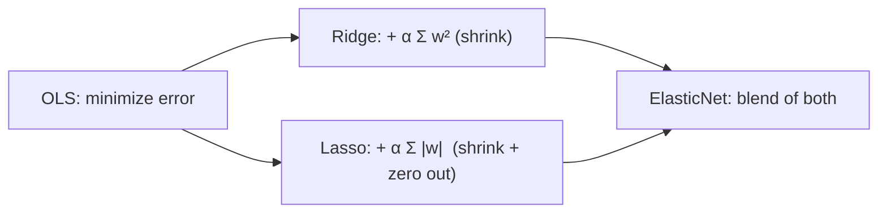

# 2.3 Ridge, Lasso & ElasticNet

### Introduction
In [2.2](2.2_polynomial.md) you fought overfitting by *removing* flexibility (lower degree). Regularization is the smarter alternative: keep all the features, but **penalize the model for using large weights**. The model stays expressive, yet is pulled toward simpler, more stable solutions — and one variant even performs feature selection for you.

### Objective
Understand how an L1 or L2 penalty shrinks coefficients, when to pick Ridge versus Lasso versus ElasticNet, and how to tune the penalty strength with cross-validation.

---

### 🪢 The "Leash" Concept
Ordinary least squares minimizes **error only**. Regularization minimizes **error + penalty on coefficient size**. The penalty is a leash: the model can pull toward a perfect fit, but every unit of coefficient costs something.

`Loss = MSE + α · penalty(w)`

- **`α` (alpha / lambda):** leash length. `α = 0` is plain OLS. Large `α` drags all weights toward zero.

#### 1. Ridge — L2 penalty: `α · Σ wᵢ²`
- Shrinks every coefficient *smoothly* toward zero, never exactly to zero.
- Excellent when features are **correlated** (multicollinearity): it spreads weight across them instead of letting one explode positive and another negative.
- Always has a closed-form solution; fast and stable.

#### 2. Lasso — L1 penalty: `α · Σ |wᵢ|`
- Shrinks coefficients and drives many of them to **exactly zero** → automatic **feature selection**.
- Great when you suspect only a handful of the 200 features matter.
- Among correlated features it picks one somewhat arbitrarily and zeroes the rest.

#### 3. ElasticNet — both: `α · (ρ·Σ|wᵢ| + (1−ρ)·Σwᵢ²)`
- `l1_ratio = ρ` blends the two. Gets Lasso's sparsity with Ridge's stability on correlated groups.
- The default choice when you do not know which regime you are in.

#### Non-negotiable: scale first
The penalty treats a coefficient of `0.002` on `assessed_value` (₱) and `450` on `floors` as if the second were 200,000× more important. **Always `StandardScaler` before any regularized model.**



### Example
```python
import numpy as np
import pandas as pd
import matplotlib.pyplot as plt
from sklearn.linear_model import LinearRegression, Ridge, Lasso, ElasticNet, RidgeCV, LassoCV
from sklearn.model_selection import train_test_split
from sklearn.pipeline import make_pipeline
from sklearn.preprocessing import StandardScaler

# 30 features, only 5 truly matter, two pairs are highly correlated
rng = np.random.default_rng(5)
n, p = 300, 30
X = rng.normal(size=(n, p))
X[:, 1] = X[:, 0] + rng.normal(0, 0.05, n)        # near-duplicate of feature 0
X[:, 3] = X[:, 2] + rng.normal(0, 0.05, n)        # near-duplicate of feature 2
true_w = np.zeros(p); true_w[[0, 2, 5, 9, 14]] = [20, -15, 10, 8, -6]
y = X @ true_w + rng.normal(0, 5, n)
X_train, X_test, y_train, y_test = train_test_split(X, y, test_size=0.3, random_state=42)

models = {
    "OLS":        LinearRegression(),
    "Ridge":      Ridge(alpha=10),
    "Lasso":      Lasso(alpha=0.5),
    "ElasticNet": ElasticNet(alpha=0.5, l1_ratio=0.5),
}
coefs = {}
for name, est in models.items():
    pipe = make_pipeline(StandardScaler(), est).fit(X_train, y_train)
    coefs[name] = pipe[-1].coef_
    nonzero = np.sum(np.abs(pipe[-1].coef_) > 1e-6)
    print(f"{name:<11} test R²={pipe.score(X_test, y_test):.3f}  non-zero coefs={nonzero:>2}")

pd.DataFrame(coefs).plot.bar(figsize=(13, 4), width=0.8)
plt.axhline(0, color="k", lw=0.5); plt.title("Coefficient by model (features 0/1 and 2/3 are near-duplicates)")

# Tune alpha with built-in cross-validation
ridge_cv = make_pipeline(StandardScaler(), RidgeCV(alphas=np.logspace(-3, 3, 30))).fit(X_train, y_train)
lasso_cv = make_pipeline(StandardScaler(), LassoCV(cv=5, random_state=0)).fit(X_train, y_train)
print(f"\nRidgeCV best alpha={ridge_cv[-1].alpha_:.3f}  test R²={ridge_cv.score(X_test, y_test):.3f}")
print(f"LassoCV best alpha={lasso_cv[-1].alpha_:.3f}  test R²={lasso_cv.score(X_test, y_test):.3f}")
print("Lasso kept features:", np.where(np.abs(lasso_cv[-1].coef_) > 1e-6)[0])
```

**Reading the output:** OLS gives the near-duplicate pairs large opposite-signed weights (unstable). Ridge splits the weight evenly between duplicates. Lasso zeroes ~25 of 30 features and usually keeps one of each duplicate pair. The CV variants pick `α` for you — always prefer them over guessing.

### 2 Use Cases
1. **Wide assessment datasets:** A parcel record with 80 attributes (many redundant: `floor_area`, `gross_area`, `net_area`) is a multicollinearity minefield for OLS. Ridge yields stable, interpretable coefficients the assessment office can publish.
2. **Finding the features that matter:** With 200 candidate socioeconomic indicators for predicting collection rates by barangay, Lasso reduces the list to the dozen that carry signal — telling the policy team *what to collect data on* next year.

### Real-World Context
In **production ML**, regularized linear models are the default for tabular problems with many features and moderate data, especially where auditability matters. The `α` chosen by cross-validation should be logged alongside the model; it is part of the model's identity and must be reproducible.
In **LLM / deep learning systems**, L2 regularization appears as **weight decay** in every optimizer config (`AdamW`). Dropout and early stopping are the neural-network cousins of the same idea — [Module 06, 2.5](../../06_neural_networks/02_intermediate/2.5_regularization.md).

### Did you know?
Lasso stands for *Least Absolute Shrinkage and Selection Operator*, coined by Robert Tibshirani in 1996. The reason L1 produces exact zeros while L2 does not is geometric: the L1 constraint region is a diamond with sharp corners on the axes, and the optimum tends to land on a corner — where some coefficients are exactly zero.

**Next:** [2.4 Regression Diagnostics](2.4_diagnostics.md)
