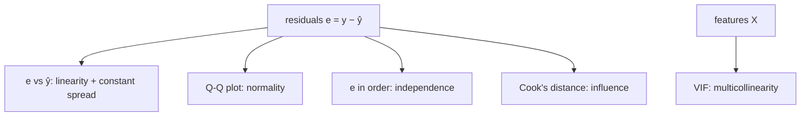

# 2.4 Regression Diagnostics

**Exercise:** [2.4_diagnostics.ipynb](../../../../Exercises/MachineLearning/01_regression/02_intermediate/2.4_diagnostics.ipynb)

### Introduction
A good R² is not proof that a linear model is appropriate. Linear regression makes **assumptions**, and when they are violated the predictions may still look fine while the coefficients, confidence intervals, and extrapolations are quietly wrong. Diagnostics are how you check the assumptions — mostly by looking at the residuals.

### Objective
Know the core assumptions of linear regression, read the four standard diagnostic plots, detect multicollinearity with VIF, and know what to do when each check fails.

---

### 🩺 The "Check-Up" Concept
The residuals `e = y − ŷ` are the model's leftovers. If the model has captured everything systematic, the leftovers should be **pure noise**: random, centered on zero, same spread everywhere, roughly normal. Each assumption is a test on that noise.

#### 1. Linearity — *is the shape right?*
- **Check:** residuals vs. predicted values. Should be a shapeless cloud around zero.
- **Violation:** a curve (U or ∩) → the true relationship is non-linear.
- **Fix:** add polynomial terms, log-transform a feature or the target, or move to a tree model.

#### 2. Homoscedasticity — *is the spread constant?*
- **Check:** same plot. Spread should be the same width left to right.
- **Violation:** a funnel (residuals grow with ŷ) → **heteroscedasticity**. Common when the target spans orders of magnitude (₱500 to ₱5M).
- **Fix:** predict `log(y)` instead of `y`; or use weighted least squares.

#### 3. Normality of residuals — *are the errors bell-shaped?*
- **Check:** histogram and **Q-Q plot** of residuals. Points should hug the diagonal.
- **Violation:** heavy tails or skew → p-values and prediction intervals are off. Predictions themselves are still unbiased.
- **Fix:** transform the target; investigate outliers; use robust regression (`HuberRegressor`).

#### 4. Independence — *are the errors unrelated to each other?*
- **Check:** residuals in row order or by time. No pattern, no waves.
- **Violation:** autocorrelation (common in time-ordered data) or grouped data (same property, many years).
- **Fix:** time-series models ([Module 07](../../07_time_series/01_beginner/1.1_intro.md)), or group-aware splitting and mixed models.

#### 5. No severe multicollinearity — *can the coefficients be trusted?*
- **Check:** **Variance Inflation Factor (VIF)** per feature. `VIF > 5` is a warning, `> 10` is a problem.
- **Violation:** unstable coefficients, sign flips, huge standard errors.
- **Fix:** drop or combine redundant features; use Ridge ([2.3](2.3_regularization.md)); use PCA ([Module 05](../../05_dimensionality/01_beginner/1.3_pca.md)).

#### 6. Influential points — *is one row steering the whole model?*
- **Check:** **Cook's distance**; leverage plot.
- **Fix:** verify the data point; if real, consider robust regression; never delete silently.



### Example
```python
import numpy as np
import pandas as pd
import matplotlib.pyplot as plt
import statsmodels.api as sm
from statsmodels.stats.outliers_influence import variance_inflation_factor
from scipy import stats

# Data with a deliberate funnel: noise grows with size (heteroscedastic)
rng = np.random.default_rng(21)
n = 400
area = rng.uniform(40, 400, n)
age = rng.integers(0, 60, n)
assessed = 15_000 * area + rng.normal(0, 50_000, n)          # strongly correlated with area
tax = 18 * area - 10 * age + 500 + rng.normal(0, 0.8 * area, n)   # noise ∝ area
df = pd.DataFrame({"area": area, "age": age, "assessed": assessed, "tax": tax})

X = sm.add_constant(df[["area", "age", "assessed"]])
ols = sm.OLS(df["tax"], X).fit()
print(ols.summary().tables[1])          # coefficients, std errors, p-values

fitted, resid = ols.fittedvalues, ols.resid
fig, ax = plt.subplots(2, 2, figsize=(11, 8))

# 1+2. Residuals vs fitted — look for curve (linearity) and funnel (heteroscedasticity)
ax[0, 0].scatter(fitted, resid, alpha=0.4); ax[0, 0].axhline(0, color="red")
ax[0, 0].set(title="Residuals vs fitted", xlabel="fitted", ylabel="residual")

# 3. Q-Q plot — normality
stats.probplot(resid, dist="norm", plot=ax[0, 1]); ax[0, 1].set_title("Q-Q plot")

# 4. Scale-location — spread vs fitted, flattened
ax[1, 0].scatter(fitted, np.sqrt(np.abs(resid / resid.std())), alpha=0.4)
ax[1, 0].set(title="Scale-location", xlabel="fitted", ylabel="sqrt |std resid|")

# 6. Influence — Cook's distance
cooks = ols.get_influence().cooks_distance[0]
ax[1, 1].stem(cooks, markerfmt=","); ax[1, 1].set(title="Cook's distance", xlabel="row")
plt.tight_layout()

# 5. VIF per feature
vif = pd.Series(
    [variance_inflation_factor(X.values, i) for i in range(1, X.shape[1])],
    index=X.columns[1:], name="VIF").round(1)
print("\n", vif)                          # expect area & assessed to be very high

# FIX for the funnel: model log(tax)
ols_log = sm.OLS(np.log(df["tax"]), sm.add_constant(df[["area", "age"]])).fit()
print(f"\nR² raw target={ols.rsquared:.3f}   R² log target={ols_log.rsquared:.3f}")
```

**Reading the output:** the first plot shows a clear funnel (heteroscedasticity); the VIF table flags `area` and `assessed` (likely > 20) as redundant; the summary's standard errors for those two will be inflated. Dropping `assessed` and modeling `log(tax)` resolves both.

### 2 Use Cases
1. **Defending a model in a hearing:** When a property owner contests an assessment formula, the office must show the model's errors are unbiased across property sizes. A funnel-shaped residual plot would be evidence the formula systematically mis-prices large properties.
2. **Catching redundant data collection:** VIF analysis showed `gross_area`, `net_area`, and `assessed_value` carried the same information. The registry stopped manually entering two of them, saving clerical time with no loss of model quality.

### Real-World Context
In **production ML**, diagnostics become **monitoring plots**: residual distribution on live predictions, segmented by district, property type, and month. A funnel that appears six months after launch means the market changed and the model needs a transform or retraining.
In **LLM / RAG systems**, the analogue is **error analysis by slice**: evaluate accuracy per document type, question length, or language. A model that is 90% accurate overall but 40% on scanned PDFs has a "heteroscedasticity" problem — and the fix is likewise upstream, in preprocessing.

### Did you know?
The four-panel diagnostic layout (residuals-vs-fitted, Q-Q, scale-location, leverage) is the default output of `plot(lm_model)` in R and has been for 30+ years. Reproducing it in Python is a rite of passage; `statsmodels` gets you most of the way, and the exercise notebook completes the set.

**Next:** [3.1 Advanced Feature Engineering](../03_advanced/3.1_features.md)
