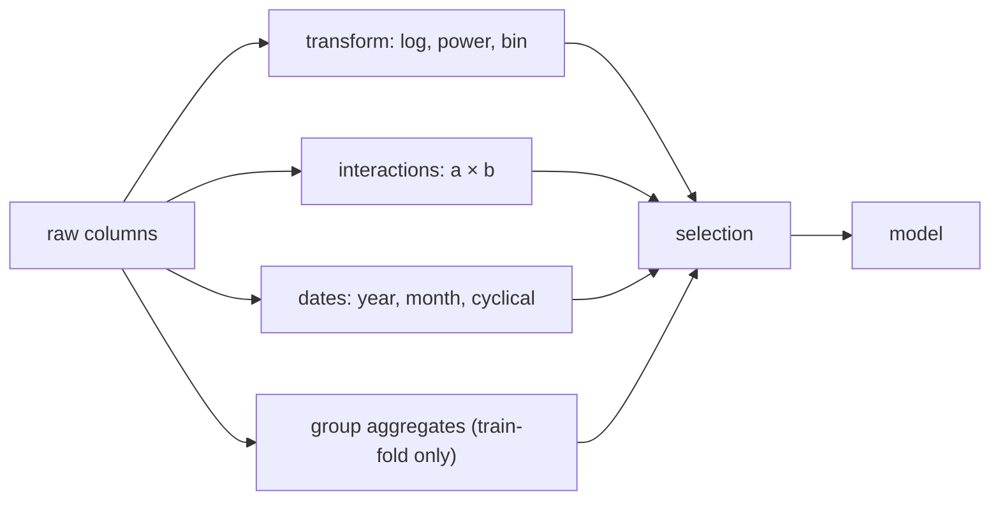

# 3.1 Advanced Feature Engineering

### Introduction
Past a certain point, a better algorithm buys you less than a better **feature**. A linear model given `tax_per_m2_in_district` will beat a tuned XGBoost given only raw columns. Feature engineering is where domain knowledge enters the model — and where the biggest leakage risks hide.

### Objective
Build interaction, transformation, date, and group-aggregate features safely inside scikit-learn pipelines; select among many candidates; and recognize when a brilliant feature is actually leakage.

---

### 🧪 The "Chef's Prep" Concept
Raw ingredients rarely go straight into the pan. The same is true of raw columns.

#### 1. Transformations — change the shape
- **`log1p(x)`** for right-skewed quantities (area, value, income). Turns multiplicative effects into additive ones a linear model can learn.
- **`sqrt`, `Box-Cox`, `Yeo-Johnson`** (`PowerTransformer`) when log is too aggressive or data has zeros/negatives.
- **Binning** (`KBinsDiscretizer`) turns a continuous feature into categories when the effect is step-like (tax brackets).

#### 2. Interactions — let features depend on each other
- `area × is_commercial`: commercial space is taxed per m² at a different rate. A linear model cannot learn that without the product term.
- `PolynomialFeatures(degree=2, interaction_only=True)` generates all pairwise products.
- Trees learn interactions automatically; linear models need them handed over.

#### 3. Date & time decomposition
- From `assessment_date`: `year`, `month`, `quarter`, `days_since_last_reassessment`, `is_fiscal_year_end`.
- Cyclical encoding for month: `sin(2π·m/12)`, `cos(2π·m/12)` so December is next to January.

#### 4. Group aggregates (target-aware — handle with care)
- `mean_tax_in_district`, `median_area_in_barangay`, `property_count_on_street`.
- **Leakage trap:** computing a group mean that includes the current row's target leaks the answer. Compute aggregates on the **training fold only** (or with out-of-fold encoding) and apply to validation/test.

#### 5. High-cardinality categoricals
- `street_name` with 4,000 levels will explode one-hot encoding. Options: **frequency encoding**, **target encoding** (`TargetEncoder`, out-of-fold by default in sklearn ≥ 1.3), or grouping rare levels into `"other"`.

#### 6. Feature selection — fewer, better
- **Filter:** correlation with target, mutual information (`SelectKBest`).
- **Wrapper:** recursive feature elimination (`RFE`).
- **Embedded:** Lasso coefficients, tree importances.
- **Permutation importance** on a held-out set is the most honest single method.



### Example
```python
import numpy as np
import pandas as pd
from sklearn.compose import ColumnTransformer
from sklearn.linear_model import RidgeCV
from sklearn.model_selection import train_test_split
from sklearn.pipeline import Pipeline, make_pipeline
from sklearn.preprocessing import (FunctionTransformer, OneHotEncoder,
                                   PolynomialFeatures, StandardScaler, TargetEncoder)
from sklearn.inspection import permutation_importance

rng = np.random.default_rng(8)
n = 1500
df = pd.DataFrame({
    "floor_area":   rng.lognormal(4.5, 0.5, n),
    "age":          rng.integers(0, 70, n),
    "is_commercial": rng.integers(0, 2, n),
    "district":     rng.choice(["north", "east", "south", "west"], n),
    "street":       rng.choice([f"st_{i}" for i in range(300)], n),     # high cardinality
    "assessed_on":  pd.to_datetime("2020-01-01") + pd.to_timedelta(rng.integers(0, 2000, n), "D"),
})
street_effect = pd.Series(rng.normal(0, 150, 300), index=[f"st_{i}" for i in range(300)])
df["tax"] = (np.where(df.is_commercial == 1, 32, 18) * df.floor_area        # interaction
             - 8 * df.age + df.street.map(street_effect) + 600 + rng.normal(0, 200, n))

# ---- Feature functions (pure, reusable in the API) ----
def add_date_parts(X):
    X = X.copy()
    X["assess_year"] = X["assessed_on"].dt.year
    m = X["assessed_on"].dt.month
    X["month_sin"], X["month_cos"] = np.sin(2 * np.pi * m / 12), np.cos(2 * np.pi * m / 12)
    return X.drop(columns="assessed_on")

numeric_log  = ["floor_area"]
numeric_raw  = ["age", "assess_year", "month_sin", "month_cos"]
interaction  = ["floor_area", "is_commercial"]
low_card     = ["district"]
high_card    = ["street"]

prep = ColumnTransformer([
    ("log",   make_pipeline(FunctionTransformer(np.log1p), StandardScaler()), numeric_log),
    ("num",   StandardScaler(), numeric_raw),
    ("inter", make_pipeline(PolynomialFeatures(2, interaction_only=True, include_bias=False), StandardScaler()), interaction),
    ("ohe",   OneHotEncoder(handle_unknown="ignore"), low_card),
    ("te",    TargetEncoder(random_state=0), high_card),       # out-of-fold inside fit → no leakage
])

model = Pipeline([
    ("dates", FunctionTransformer(add_date_parts)),
    ("prep", prep),
    ("reg", RidgeCV(alphas=np.logspace(-2, 3, 20))),
])

X, y = df.drop(columns="tax"), df["tax"]
X_tr, X_te, y_tr, y_te = train_test_split(X, y, test_size=0.25, random_state=42)
model.fit(X_tr, y_tr)
print(f"test R² with engineered features = {model.score(X_te, y_te):.3f}")

# Honest importance: permutation on the test set, by ORIGINAL column
imp = permutation_importance(model, X_te, y_te, n_repeats=10, random_state=0, scoring="r2")
print(pd.Series(imp.importances_mean, index=X_te.columns).sort_values(ascending=False).round(3))
```

**Reading the output:** the interaction term lets Ridge learn the separate commercial rate; `TargetEncoder` compresses 300 streets into one informative column without leaking; permutation importance tells you `floor_area`, `is_commercial`, and `street` matter while `assessed_on` barely does — which is a candidate to drop.

### 2 Use Cases
1. **Dual rate structures:** Residential and commercial parcels are taxed at different per-m² rates. The `area × is_commercial` interaction lets one linear model serve both and report each rate explicitly — a requirement for the public rate schedule.
2. **Neighbourhood effects without 4,000 columns:** Target-encoding `street` captures micro-location value (corner lots, main roads) that no coarse `district` dummy can, while keeping the model small enough to explain and fast enough to serve.

### Real-World Context
In **production ML**, feature engineering code is the part of the system most likely to differ between training and serving. The defense is what you see above: every transformation lives inside the `Pipeline`, so `joblib.dump(model)` ships the features along with the weights. A **feature store** is the enterprise version of the same idea.
In **LLM / RAG systems**, feature engineering is **metadata engineering**: extracting `document_date`, `section`, `department`, and `language` at index time so the retriever can filter before similarity search. The leakage lesson transfers too — never put the answer in the metadata.

### Did you know?
The winning solutions of most tabular Kaggle competitions attribute more of their edge to feature engineering than to model choice. Target encoding in particular was popularized by competitors years before it entered scikit-learn in version 1.3 (2023).

**Next:** [3.2 Hyperparameter Optimization](3.2_tuning.md)
