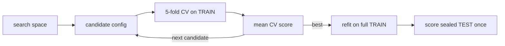

# 3.2 Hyperparameter Optimization

**Exercise:** [3.2_tuning.ipynb](../../../../Exercises/MachineLearning/01_regression/03_advanced/3.2_tuning.ipynb)

### Introduction
Parameters are what the model learns (`w`, `b`). **Hyperparameters** are what *you* set before training: Ridge's `α`, polynomial degree, tree depth, learning rate. Picking them by hand is guesswork; picking them on the test set is cheating. Hyperparameter optimization is the systematic, leak-free way to search.

### Objective
Use `GridSearchCV` and `RandomizedSearchCV` to tune whole pipelines with cross-validation, read the results, avoid the nested-validation trap, and know when to reach for smarter search.

---

### 🎛️ The "Mixing Desk" Concept
A model is a mixing desk with knobs. Each knob setting produces a different sound (score). You want the best setting — without listening to the final audience (test set) until the very end.

#### 1. The search space
Decide which knobs and which values. For a Ridge pipeline: `alpha ∈ {0.01, …, 1000}`, `poly degree ∈ {1, 2, 3}`. For trees: `max_depth`, `n_estimators`, `learning_rate`.

#### 2. The scoring rule
Each candidate is scored by **k-fold cross-validation on the training set only**. The mean CV score decides. The test set stays sealed.

#### 3. Grid vs. Random
| Method | How | Best when |
| --- | --- | --- |
| **GridSearchCV** | tries *every* combination | ≤ 3 knobs, small discrete sets |
| **RandomizedSearchCV** | samples `n_iter` random combinations from distributions | many knobs, continuous ranges; same budget finds better optima |
| **HalvingGridSearchCV / HalvingRandomSearchCV** | successive halving: cheap evaluation of many, full evaluation of survivors | expensive models |
| **Bayesian (Optuna)** | models the score surface and proposes promising points | expensive models, many knobs — [Ensemble 3.3](../../03_ensemble/03_advanced/3.3_optuna.md) |

#### 4. The nested-validation trap
If you tune on CV folds and then *also* report the best CV score as your final result, that number is **optimistically biased** — you picked the max of many noisy estimates. Report the score on the sealed test set, or use nested CV when data is small.

#### 5. Tune the pipeline, not the model
Preprocessing choices (scaler type, degree, encoder) are hyperparameters too. Put the whole `Pipeline` inside the search; refer to knobs as `step__param`.



### Example
```python
import numpy as np
import pandas as pd
from scipy.stats import loguniform, randint
from sklearn.ensemble import GradientBoostingRegressor
from sklearn.linear_model import Ridge
from sklearn.model_selection import (GridSearchCV, RandomizedSearchCV,
                                     KFold, train_test_split)
from sklearn.pipeline import Pipeline
from sklearn.preprocessing import PolynomialFeatures, StandardScaler

rng = np.random.default_rng(13)
n = 800
area = rng.uniform(40, 300, n); age = rng.integers(0, 60, n); lot = rng.uniform(60, 800, n)
tax = 18 * area - 12 * age + 0.004 * area * lot + 500 + rng.normal(0, 250, n)
X = pd.DataFrame({"area": area, "age": age, "lot": lot}); y = tax
X_tr, X_te, y_tr, y_te = train_test_split(X, y, test_size=0.2, random_state=42)
cv = KFold(5, shuffle=True, random_state=42)

# ---- 1. GridSearch over a Ridge pipeline (degree + alpha) ----
ridge_pipe = Pipeline([("poly", PolynomialFeatures()), ("scale", StandardScaler()), ("reg", Ridge())])
grid = {
    "poly__degree": [1, 2, 3],
    "reg__alpha": np.logspace(-2, 3, 12),
}
gs = GridSearchCV(ridge_pipe, grid, cv=cv, scoring="neg_root_mean_squared_error", n_jobs=-1)
gs.fit(X_tr, y_tr)
print("Ridge best:", gs.best_params_, f"CV RMSE={-gs.best_score_:.0f}")

# Inspect the landscape, not just the winner
res = pd.DataFrame(gs.cv_results_)[["param_poly__degree", "param_reg__alpha", "mean_test_score", "std_test_score"]]
print(res.sort_values("mean_test_score", ascending=False).head(5).round(1))

# ---- 2. RandomizedSearch over Gradient Boosting (many knobs) ----
gb_space = {
    "n_estimators": randint(100, 600),
    "max_depth": randint(2, 6),
    "learning_rate": loguniform(0.01, 0.3),
    "subsample": [0.6, 0.8, 1.0],
    "min_samples_leaf": randint(1, 20),
}
rs = RandomizedSearchCV(GradientBoostingRegressor(random_state=0), gb_space, n_iter=40,
                        cv=cv, scoring="neg_root_mean_squared_error", n_jobs=-1, random_state=0)
rs.fit(X_tr, y_tr)
print("GB best:", rs.best_params_, f"CV RMSE={-rs.best_score_:.0f}")

# ---- 3. Final, honest comparison on the sealed test set (once) ----
for name, search in [("Ridge", gs), ("GradBoost", rs)]:
    pred = search.best_estimator_.predict(X_te)           # best_estimator_ is already refit on full X_tr
    rmse = np.sqrt(np.mean((y_te - pred) ** 2))
    print(f"{name:<10} TEST RMSE = {rmse:.0f}")
```

**Reading the output:** the grid table shows whether the optimum is on the *edge* of your range (then widen it). `std_test_score` tells you how stable each configuration is — prefer a slightly worse mean with much lower std. Test RMSE will typically be a bit worse than the best CV RMSE; that gap is the optimism bias in action.

### 2 Use Cases
1. **Reproducible model selection for audit:** A tax model's `α` and `degree` were chosen by `GridSearchCV` with a fixed `random_state`; the full `cv_results_` table is archived with the model. When an auditor asks "why these settings?", the answer is a table, not a memory.
2. **Budgeted tuning:** A gradient-boosting model with seven knobs would need 50,000 grid points. `RandomizedSearchCV(n_iter=60)` finds a configuration within 1–2% of the best in an hour instead of a week.

### Real-World Context
In **production ML**, tuning runs are tracked in an experiment tracker (MLflow, Weights & Biases) with parameters, CV scores, and the resulting artifact. Retraining pipelines usually re-run a *narrow* search around the last known optimum rather than the full space.
In **LLM / RAG systems**, the knobs are `chunk_size`, `chunk_overlap`, `k`, embedding model, and temperature. The discipline is identical: define a scoring function on a held-out question set, search systematically, and never tune on the questions you report. LangChain [3.4 Chunking Strategies](../../../Langchain/03_advanced/3.4_chunking_strategies.md) is a hyperparameter search in disguise.

### Did you know?
Bergstra & Bengio's 2012 paper showed that random search beats grid search for most problems because only a few hyperparameters usually matter — grid search wastes its budget re-testing the unimportant ones at every value of the important ones.

**Next:** [3.3 Regression Model Explainability](3.3_explainability.md)
