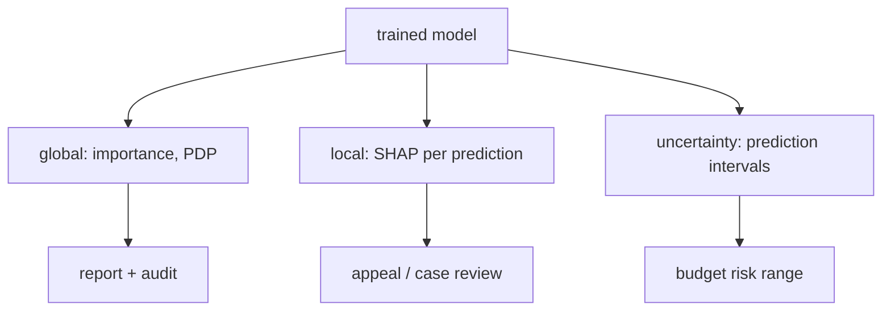

# 3.3 Regression Model Explainability

### Introduction
A tax prediction that cannot be explained cannot be appealed, audited, or trusted. Explainability answers three different questions: **which features matter overall** (global), **why this particular prediction** (local), and **how sure is the model** (uncertainty). Linear models answer the first two for free; for anything more complex you need tools.

### Objective
Explain regression models at global and local levels using coefficients, permutation importance, partial dependence, and SHAP; and attach prediction intervals so every forecast carries an honest range.

---

### 🔦 The "Three Flashlights" Concept

#### 1. Global — *what drives predictions in general?*
- **Standardized coefficients** (linear models): the effect of a one-standard-deviation change in each feature. Directly comparable.
- **Permutation importance**: shuffle one feature on held-out data and measure how much the score drops. Model-agnostic, honest, and cheap.
- **Partial dependence plots (PDP)**: average prediction as one feature varies, others held at their data values. Shows the *shape* of each effect, including non-linearities a coefficient would hide.

#### 2. Local — *why ₱2,640 for this property?*
- **Linear models:** the contribution of each feature is literally `wᵢ · xᵢ`. Sum them, add the intercept, you have the prediction and the explanation.
- **SHAP (SHapley Additive exPlanations):** generalizes that decomposition to any model. Each feature gets a signed contribution; they always sum to `prediction − average prediction`. `TreeExplainer` is exact and fast for tree ensembles; `LinearExplainer` for linear; `KernelExplainer` for anything.

#### 3. Uncertainty — *how far off could this be?*
- **Prediction interval** (not confidence interval): a range that should contain the actual value, say, 90% of the time.
- **Quantile regression:** fit models for the 5th and 95th percentiles directly (`QuantileRegressor`, `GradientBoostingRegressor(loss="quantile")`).
- **Conformal prediction:** wrap *any* model; calibrate interval width on a held-out set so coverage is guaranteed. The modern default (`mapie` library).
- **statsmodels OLS:** gives analytic intervals for linear models when assumptions hold.



### Example
```python
import numpy as np
import pandas as pd
import matplotlib.pyplot as plt
from sklearn.ensemble import GradientBoostingRegressor
from sklearn.inspection import permutation_importance, PartialDependenceDisplay
from sklearn.model_selection import train_test_split

rng = np.random.default_rng(17)
n = 1200
df = pd.DataFrame({
    "area": rng.uniform(40, 300, n),
    "age": rng.integers(0, 70, n),
    "lot": rng.uniform(60, 800, n),
    "dist_cbd_km": rng.uniform(0.5, 25, n),
})
df["tax"] = (18 * df.area - 10 * df.age + 1.2 * df.lot
             + 2500 * np.exp(-df.dist_cbd_km / 6)              # non-linear location premium
             + 400 + rng.normal(0, 200, n))
X, y = df.drop(columns="tax"), df["tax"]
X_tr, X_te, y_tr, y_te = train_test_split(X, y, test_size=0.25, random_state=42)

gb = GradientBoostingRegressor(n_estimators=300, max_depth=3, learning_rate=0.05, random_state=0).fit(X_tr, y_tr)
print(f"test R² = {gb.score(X_te, y_te):.3f}")

# ---- GLOBAL: permutation importance + partial dependence ----
pi = permutation_importance(gb, X_te, y_te, n_repeats=15, random_state=0)
print(pd.Series(pi.importances_mean, index=X.columns).sort_values(ascending=False).round(3))

fig, ax = plt.subplots(1, 2, figsize=(11, 4))
PartialDependenceDisplay.from_estimator(gb, X_te, ["dist_cbd_km", "age"], ax=ax)
plt.suptitle("Partial dependence: shape of each effect")

# ---- LOCAL: SHAP for one property ----
import shap
explainer = shap.TreeExplainer(gb)
shap_values = explainer.shap_values(X_te)
i = 0
contrib = pd.Series(shap_values[i], index=X.columns).round(0)
print(f"\nProperty {X_te.index[i]}: predicted ₱{gb.predict(X_te.iloc[[i]])[0]:,.0f}  "
      f"(average ₱{explainer.expected_value:,.0f})")
print(contrib.sort_values(key=abs, ascending=False))
shap.summary_plot(shap_values, X_te, show=False)                 # global view from local values

# ---- UNCERTAINTY: 90% prediction interval via quantile boosting ----
q05 = GradientBoostingRegressor(loss="quantile", alpha=0.05, n_estimators=300, max_depth=3, random_state=0).fit(X_tr, y_tr)
q95 = GradientBoostingRegressor(loss="quantile", alpha=0.95, n_estimators=300, max_depth=3, random_state=0).fit(X_tr, y_tr)
lo, hi = q05.predict(X_te), q95.predict(X_te)
coverage = np.mean((y_te >= lo) & (y_te <= hi))
print(f"\n90% interval — empirical coverage: {coverage:.1%}, mean width: ₱{np.mean(hi - lo):,.0f}")
```

**Reading the output:** permutation importance ranks `area` first; the PDP for `dist_cbd_km` reveals the exponential decay a coefficient could never show. The SHAP breakdown turns one prediction into a sentence: "₱2,640 = ₱2,100 average + ₱820 for size − ₱310 for age + ₱30 location." Coverage near 90% means the intervals are honest.

### 2 Use Cases
1. **Assessment appeals:** A property owner disputes a ₱3,200 bill. The SHAP table shows ₱1,100 of it comes from `lot` size — and the owner proves the registry's lot figure is wrong. The explanation located a data error that a bare prediction would have hidden.
2. **Budget planning under uncertainty:** Instead of "₱412M expected collections," the treasury receives "₱395M–₱428M with 90% confidence." The lower bound drives the conservative budget; the upper bound sizes the contingency.

### Real-World Context
In **production ML**, explanations are increasingly a **legal requirement** (GDPR's right to explanation, fair-lending rules, public-sector transparency acts). SHAP values are typically computed at inference time and stored with each prediction so any decision can be reconstructed later.
In **LLM / RAG systems**, the explainability analogue is **citations**: showing which retrieved chunks produced the answer (LangChain [2.3 Structured Output](../../../Langchain/02_intermediate/2.3_structured_output.md)). And uncertainty maps to the `confidence` field that triggers a fallback — the same "know when you don't know" discipline.

### Did you know?
Shapley values come from 1953 cooperative game theory: how to fairly split a team's winnings among players by their marginal contributions. Scott Lundberg's 2017 SHAP paper noticed that "players" could be features and "winnings" a prediction — and the only fair split satisfying a few axioms is the Shapley one.

**Next:** [3.4 Regression Deployment](3.4_deployment.md)
