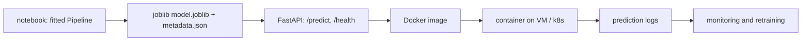

# 3.4 Regression Deployment

**Exercise:** [3.4_deployment.ipynb](../../../../Exercises/MachineLearning/01_regression/03_advanced/3.4_deployment.ipynb)

### Introduction
A model in a notebook helps one person. A model behind an API helps the whole organization. Deployment is the step that turns `model.predict(X)` into a service other systems can call — reliably, reproducibly, and with a record of every prediction it makes.

### Objective
Serialize a fitted pipeline, wrap it in a FastAPI service with validated inputs, containerize it with Docker, and build in the logging that makes monitoring possible later.

---

### 🚢 The "Shipping Container" Concept
The pipeline you trained is cargo. To ship it you need a sealed box (serialization), a dock with a standard interface (API), a standard container that runs anywhere (Docker), and a manifest of what went in and out (logging).

#### 1. Serialize the *whole pipeline*
- `joblib.dump(pipeline, "model.joblib")` — includes scalers, encoders, and the regressor. One file, one `predict`.
- Pin the scikit-learn version. A pickle from 1.4 may not load in 1.6.
- Save metadata alongside: training date, data version, CV metrics, feature list, git commit.

#### 2. Expose via FastAPI
- **Pydantic schema** for the request: types, ranges, required fields. Garbage in is rejected at the door with a clear 422 error.
- `POST /predict` → returns prediction *plus* model version and (ideally) an interval or explanation.
- `GET /health` → load balancers and orchestrators need it.

#### 3. Containerize
- `Dockerfile`: slim Python base, install pinned requirements, copy artifact + app, run `uvicorn`.
- Same image runs on your laptop, a VM, and Kubernetes. "Works on my machine" stops being a sentence.

#### 4. Log everything
- Every request: timestamp, inputs, prediction, model version, latency.
- These logs are the raw material for drift monitoring and for computing real MAE once actual bills are known.

#### 5. Batch vs. real-time
- **Batch:** score all 400,000 parcels nightly into a table. Simpler, cheaper, fits most tax use cases.
- **Real-time:** an API answering "estimate my tax" on a public website. Needs latency targets, autoscaling, rate limits.



### Example
**Step 1 — in the notebook: train, evaluate, export.**

```python
import json, joblib
from datetime import datetime, timezone
import numpy as np, pandas as pd, sklearn
from sklearn.compose import ColumnTransformer
from sklearn.linear_model import RidgeCV
from sklearn.model_selection import cross_val_score, train_test_split
from sklearn.pipeline import Pipeline
from sklearn.preprocessing import OneHotEncoder, StandardScaler

rng = np.random.default_rng(42); n = 1000
df = pd.DataFrame({"floor_area": rng.uniform(40, 300, n), "age": rng.integers(0, 60, n),
                   "district": rng.choice(["north", "east", "south", "west"], n)})
df["tax"] = 18 * df.floor_area - 12 * df.age + df.district.map({"north": 600, "east": 0, "south": -300, "west": 250}) + 400 + rng.normal(0, 200, n)

prep = ColumnTransformer([("num", StandardScaler(), ["floor_area", "age"]),
                          ("cat", OneHotEncoder(handle_unknown="ignore"), ["district"])])
pipe = Pipeline([("prep", prep), ("reg", RidgeCV(alphas=np.logspace(-2, 2, 20)))])
X, y = df.drop(columns="tax"), df["tax"]
X_tr, X_te, y_tr, y_te = train_test_split(X, y, test_size=0.2, random_state=42)
pipe.fit(X_tr, y_tr)

rmse = float(np.sqrt(np.mean((y_te - pipe.predict(X_te)) ** 2)))
joblib.dump(pipe, "model.joblib")
json.dump({
    "model_version": "tax-ridge-1.0.0",
    "trained_at": datetime.now(timezone.utc).isoformat(),
    "sklearn_version": sklearn.__version__,
    "features": list(X.columns),
    "test_rmse": round(rmse, 1),
}, open("metadata.json", "w"), indent=2)
print("exported; test RMSE =", round(rmse))
```

**Step 2 — `app.py`: the service.**

```python
import json, logging, time
from typing import Literal
import joblib, pandas as pd
from fastapi import FastAPI
from pydantic import BaseModel, Field

logging.basicConfig(level=logging.INFO, format="%(message)s")
model = joblib.load("model.joblib")
meta = json.load(open("metadata.json"))
app = FastAPI(title="Property Tax Estimator", version=meta["model_version"])

class Property(BaseModel):
    floor_area: float = Field(gt=0, lt=10_000, description="m²")
    age: int = Field(ge=0, le=200, description="years")
    district: Literal["north", "east", "south", "west"]

class Prediction(BaseModel):
    tax_estimate: float
    model_version: str
    typical_error: float          # RMSE from evaluation, so callers know the uncertainty

@app.get("/health")
def health():
    return {"status": "ok", "model_version": meta["model_version"]}

@app.post("/predict", response_model=Prediction)
def predict(p: Property):
    t0 = time.perf_counter()
    X = pd.DataFrame([p.model_dump()])
    y_hat = float(model.predict(X)[0])
    logging.info(json.dumps({"ts": time.time(), "input": p.model_dump(), "pred": round(y_hat, 2),
                             "model": meta["model_version"], "latency_ms": round((time.perf_counter() - t0) * 1000, 2)}))
    return Prediction(tax_estimate=round(y_hat, 2), model_version=meta["model_version"], typical_error=meta["test_rmse"])
```

**Step 3 — `Dockerfile` and run.**

```dockerfile
FROM python:3.11-slim
WORKDIR /app
COPY requirements-serve.txt .
RUN pip install --no-cache-dir -r requirements-serve.txt   # fastapi uvicorn scikit-learn==<pinned> pandas joblib
COPY model.joblib metadata.json app.py .
EXPOSE 8000
CMD ["uvicorn", "app:app", "--host", "0.0.0.0", "--port", "8000"]
```

```bash
docker build -t tax-estimator:1.0.0 .
docker run -d -p 8000:8000 --name tax-api tax-estimator:1.0.0

curl -s localhost:8000/health
curl -s -X POST localhost:8000/predict -H "Content-Type: application/json" \
     -d '{"floor_area": 120, "age": 15, "district": "north"}'
# {"tax_estimate": 2994.5, "model_version": "tax-ridge-1.0.0", "typical_error": 203.4}

curl -s -X POST localhost:8000/predict -H "Content-Type: application/json" \
     -d '{"floor_area": -5, "age": 15, "district": "central"}'
# 422 Unprocessable Entity — Pydantic rejects it before the model ever sees it
```

Interactive docs appear automatically at `http://localhost:8000/docs`.

### 2 Use Cases
1. **Nightly batch assessment:** A cron job calls the same container's Python module (not HTTP) to score every parcel and write results to the assessment database. The API and the batch job share one artifact, so they can never disagree.
2. **Citizen self-service estimator:** The city portal calls `/predict` when a resident enters their property details. The `typical_error` field lets the page display "estimated ₱2,995 ± ₱200" instead of a falsely precise number.

### Real-World Context
In **production ML**, this pattern — artifact + metadata + FastAPI + Docker + structured logs — is the minimum viable deployment. From here you add a model registry (MLflow), CI that re-runs the evaluation before building the image, canary releases, and drift dashboards fed by the logs. [Ensemble 3.5](../../03_ensemble/03_advanced/3.5_production.md) continues the story.
In **LLM / RAG systems**, LangChain [3.7 Production Migration](../../../Langchain/03_advanced/3.7_prod_migration.md) does the same thing with LangServe: the chain is the artifact, Pydantic validates inputs, Docker packages it, and every call is logged for evaluation. One deployment skill set serves both tracks.

### Did you know?
The scikit-learn team recommends **`skops`** over pickle/joblib for sharing models across trust boundaries: pickle can execute arbitrary code on load, so never load a `.joblib` from an untrusted source. Inside your own pipeline it is fine; across the internet it is a security hole.

**Capstone:** [Project 01 — Property Tax Prediction](../../../../Projects/MachineLearning/01_property_tax_prediction/README.md)
**Next module:** [02 Classification — 1.1 Introduction](../../02_classification/01_beginner/1.1_intro.md)
